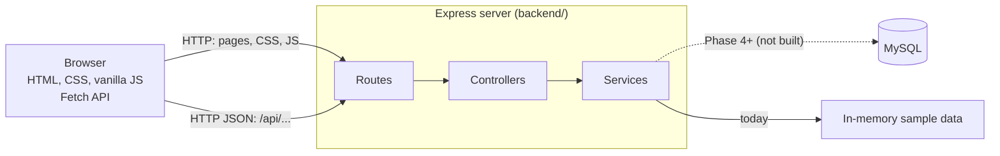
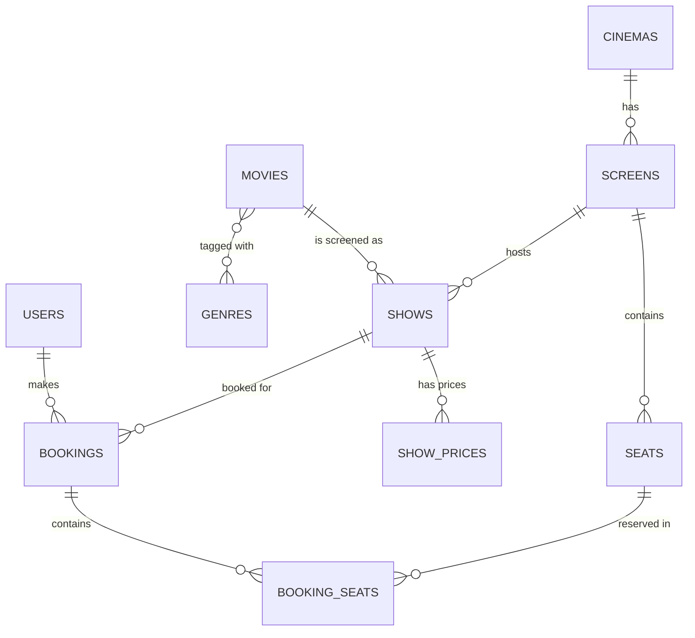
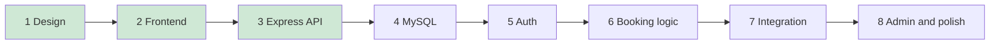

# BOOK_MY_SEAT: Phase 1 Report (Project Foundation)

| | |
|---|---|
| **Project** | BOOK_MY_SEAT, an academic Full Stack Development project (movie ticket booking website) |
| **Phase** | 1 of 8: requirements, architecture, database relationships, API contract, folder structure |
| **Report written** | 2026-10-31, after Phases 1 to 3 were complete |
| **Project root** | `E:\BOOK MY SEAT` (contains `frontend/` and `backend/`) |

## 0. How to read this report (evidence and limits)

Phase 1 was a **design phase**. By its own rules it created **no source code, no SQL and no documentation files** (verified: before Phase 2 the project folder was empty, and today no `README.md`, `docs/api.md`, `docs/database-design.md` or root `.gitignore` exists).

This report therefore mixes two kinds of statements, and marks them:

- **[Source-verified]** means confirmed today by reading the actual files in the project.
- **[Design-only]** means it exists only as the Phase 1 design that you approved (the original project instruction document plus the approved decisions). It is **not** present in any file, and nothing in this report should be read as "the database exists" or "the API exists".

Things that could not be verified from source are labelled **"cannot be verified from source"**.

> **Inspection note:** this report was prepared by inspecting a working copy of the project available to the author of this document, which contains `frontend/` and `backend/` exactly as delivered in Phases 2 and 3. The folder `E:\BOOK MY SEAT` itself could not be accessed. If you changed files locally after copying them, those changes are not reflected here.

---

## 1. Project overview and objectives

BOOK_MY_SEAT is a movie-ticket booking web application, inspired by the *general experience* of Indian booking platforms but with its **own original branding and UI**. It must demonstrate the concepts of a Full Stack Development syllabus: HTML/CSS/vanilla JavaScript on the frontend, Node.js and Express on the backend, MySQL as the database, REST APIs, MVC, JWT authentication, and transactions for reliable bookings.

**Objectives**

1. A user can register, log in, browse and search movies, pick a cinema, date and showtime, choose seats, review a price summary, confirm a booking, view a ticket with a unique reference, see past bookings and cancel eligible bookings.
2. An administrator can eventually manage movies, cinemas, screens, seats, shows, prices and bookings.
3. A seat can **never** be booked twice for the same show, even when two users try at the same moment.
4. Prices are always calculated from trusted server-side data.
5. No real payment is taken, and a booking must never be presented as a real payment.
6. The student who builds it must be able to *explain* it (viva), so code is kept simple and well explained.

## 2. Requirements

### 2.1 Functional requirements and where they stand today

| # | Requirement | Status today (verified from source) |
|---|---|---|
| FR-1 | Register and log in | **UI only.** `login.html`, `register.html` with client-side validation exist. No account is created and nobody is logged in (no backend auth). |
| FR-2 | Browse, search and filter movies | **Implemented in the frontend** with sample data. The backend also exposes read endpoints, but the frontend does not call them yet. |
| FR-3 | View movie details | **Implemented** (frontend, sample data). |
| FR-4 | Select cinema, date and showtime | **Implemented** (frontend, sample data). |
| FR-5 | View available seats for a specific show | **Simulated.** The seat map is generated in the browser; "booked" seats come from a deterministic formula, not a database. |
| FR-6 | Select multiple seats | **Implemented** (client side, maximum 6). |
| FR-7 | Booking summary and total price | **Implemented** (client side, cinema-specific sample prices). |
| FR-8 | Confirm a booking | **Not implemented.** The "Confirm booking" button only shows a "nothing was booked" note. |
| FR-9 | Ticket with unique booking reference | **Pending.** |
| FR-10 | My Bookings page | **Pending.** |
| FR-11 | Cancel eligible bookings | **Pending.** |
| FR-12 | Logout | **Pending** (no sessions exist yet). |
| FR-13 | Admin: movies, cinemas, screens, seats, shows, prices, bookings | **Pending** (planned for Phase 8). |

### 2.2 Non-functional requirements

| Area | Requirement | Status |
|---|---|---|
| Security | Passwords stored as bcrypt hashes; signed JWT; HttpOnly cookie plus CSRF protection; role-based authorization; rate limiting on login and register; no secrets in Git; no SQL or stack-trace leakage | **Partially in place:** secure headers, input validation, generic 500 errors, `.env` ignored in `backend/.gitignore` (Phase 3). Everything auth-related is pending. |
| Data integrity | MySQL transactions; unique and foreign-key constraints; server-side prices | **Pending** (Phases 4 and 6). |
| Accessibility | Labelled forms, keyboard operable seat map, visible focus | **Implemented** in the frontend (see Phase 2 report). |
| Responsiveness | Desktop, tablet and mobile layouts | **Implemented** (CSS media queries, see Phase 2 report). |
| Maintainability | Clear separation of frontend, backend and database; MVC with a service layer; central error handling | **Implemented for the backend as built so far** (Phase 3). |
| Usability for a student project | Easy to run locally; beginner-friendly explanations; honest testing claims | Ongoing. |
| Branding | Original BOOK_MY_SEAT identity; do not copy another platform's assets | **Implemented**; all movie titles, cinemas and descriptions in the sample data are invented. |

## 3. Technology stack and purpose

| Layer | Technology | Purpose | Status |
|---|---|---|---|
| Frontend | HTML5, CSS3, vanilla JavaScript ES2015+ (ES modules) | Pages, styling, interactivity; no framework, to match the syllabus | In use |
| Frontend | Fetch API and JSON | Talk to the REST API | Prepared (`frontend/js/api.js` has a switch, off) |
| Backend | Node.js (project owner uses v22.21.0), npm 10.9.4 | JavaScript runtime and package manager | In use |
| Backend | Express.js 5.3.0 | HTTP server, routing, middleware | In use |
| Backend | dotenv 18.0.7 | Load configuration from a `.env` file | In use |
| Backend | helmet 8.3.0 | Secure HTTP headers | In use (added in Phase 3; not in the original Phase 1 list) |
| Database | MySQL Server 8.0.44, `mysql2` driver | Persistent data, transactions, constraints | **Not installed or used yet** (Phase 4) |
| Auth | `bcrypt`, `jsonwebtoken`, `cookie-parser`, `express-rate-limit` | Password hashing, tokens, cookies, throttling | **Not installed yet** (Phase 5) |
| Tooling | Git and GitHub, VS Code, API testing tools, browser DevTools | Version control and development | Cannot be verified from source (no Git metadata was present in the inspected copy) |

Explicitly excluded by the project rules: React, TypeScript, MongoDB, any ORM. **[Source-verified]** none of these appear in `backend/package.json` and the frontend has no `package.json` at all.

Actual backend dependencies today **[Source-verified]**:

```json
  "dependencies": {
    "dotenv": "18.0.7",
    "express": "5.3.0",
    "helmet": "8.3.0"
  }
```

## 4. Initial architecture

### 4.1 Single-origin design (approved decision)

Express serves **both** the static frontend files and the JSON API from one address (for example `http://localhost:3000`). This avoids CORS configuration entirely, makes cookie-based login simpler and safer, and is easy to demonstrate.



The solid line to "In-memory sample data" is what exists today (Phase 3). The dotted line to MySQL is **[Design-only]**.

### 4.2 Layering (MVC with a service layer)

| Layer | Responsibility | Must not |
|---|---|---|
| Routes | Map URL and method to a controller | contain logic |
| Controllers | Read and validate the request, call a service, send the response | contain business rules or SQL |
| Services | Business rules, and (from Phase 4) SQL | know about HTTP |
| Middleware | Cross-cutting work: security headers, logging, JWT check, role check, error handling | |
| Validators | Check every piece of client input | trust the client |

### 4.3 Planned authentication flow **[Design-only]**

Login verifies the bcrypt hash, signs a JWT and sets it in an **HttpOnly, SameSite=Lax cookie** (plus `Secure` in production). JavaScript never reads the token. State-changing requests will also need a CSRF token in a header. Rate limiting protects login and register. **None of this exists yet.**

## 5. Folder structure

### 5.1 Proposed in Phase 1 **[Design-only]**

```text
BOOK_MY_SEAT/
  frontend/  (index.html, pages/, css/, js/, assets/)
  backend/   (package.json, .env.example, server.js, app.js, config/, routes/,
              controllers/, services/, middleware/, validators/)
  database/  (schema.sql, seed.sql)
  docs/      (api.md, database-design.md)
  README.md
  .gitignore
```

### 5.2 Actual structure today **[Source-verified]**

```text
./
|-- backend/
|   |-- config/
|   |   `-- env.js
|   |-- controllers/
|   |   |-- health.controller.js
|   |   `-- movie.controller.js
|   |-- data/
|   |   `-- sample-data.js
|   |-- middleware/
|   |   |-- errorHandler.js
|   |   |-- notFound.js
|   |   `-- requestLogger.js
|   |-- routes/
|   |   |-- index.js
|   |   `-- movie.routes.js
|   |-- services/
|   |   `-- movie.service.js
|   |-- tests/
|   |   `-- api.test.js
|   |-- utils/
|   |   |-- AppError.js
|   |   `-- response.js
|   |-- validators/
|   |   `-- params.js
|   |-- .env.example
|   |-- .gitignore
|   |-- app.js
|   |-- package-lock.json
|   |-- package.json
|   `-- server.js
|-- docs/
|   `-- phase-reports/
|       |-- PHASE_1_REPORT.md
|       |-- PHASE_2_REPORT.md
|       `-- PHASE_3_REPORT.md
`-- frontend/
    |-- assets/
    |   `-- favicon.svg
    |-- css/
    |   |-- auth.css
    |   |-- base.css
    |   |-- components.css
    |   |-- seats.css
    |   `-- tokens.css
    |-- js/
    |   |-- data/
    |   |   `-- sample-data.js
    |   |-- pages/
    |   |   |-- auth.js
    |   |   |-- coming-soon.js
    |   |   |-- home.js
    |   |   |-- movie.js
    |   |   |-- movies.js
    |   |   `-- seats.js
    |   |-- api.js
    |   |-- components.js
    |   |-- utils.js
    |   `-- validators.js
    |-- pages/
    |   |-- coming-soon.html
    |   |-- login.html
    |   |-- movie.html
    |   |-- movies.html
    |   |-- register.html
    |   `-- seats.html
    |-- tests/
    |   `-- validators.test.mjs
    `-- index.html
```

(`node_modules/` is not shown. It is created locally by `npm install` and must never be committed. The `docs/` folder contains only the three phase reports.)

### 5.3 Differences from the Phase 1 proposal

| Proposal | Reality | Why |
|---|---|---|
| `database/schema.sql`, `seed.sql` | Not created | Phase 4 |
| `docs/api.md`, `docs/database-design.md`, `README.md` | Not created | Phase 8 (documentation). These reports are the only docs so far. |
| Root `.gitignore` | Not created; a `.gitignore` exists only in `backend/` | Added when `.env` and `node_modules` first appeared (Phase 3). A root-level one is still recommended. |
| `backend/` had 6 folders | Has 8: **`utils/`** and **`data/`** added | `utils/` holds the shared `AppError` class and response helper; `data/` holds the temporary sample data. |
| Frontend: `pages/`, `css/`, `js/`, `assets/` | Same, plus `js/data/`, `js/pages/`, `tests/` | Organisation grew with the features. |

## 6. Planned database design **[Design-only: no SQL file or table exists]**

Normalised MySQL schema (third normal form). The eight originally required tables plus three that were approved as additions:

| Table | Key columns | Notes |
|---|---|---|
| `users` | id, name, email, password_hash, role (USER or ADMIN), created_at | `UNIQUE(email)` |
| `movies` | id, title, description, language, duration_min, certificate, release_date, poster_url, is_active | |
| `genres`, `movie_genres` | genre id and name; movie_id with genre_id | *Added:* resolves the many-to-many relation so genre filters stay normalised |
| `cinemas` | id, name, city, address | |
| `screens` | id, cinema_id, name | `UNIQUE(cinema_id, name)` |
| `seats` | id, screen_id, row_label, seat_number, category (STANDARD, PREMIUM, RECLINER) | `UNIQUE(screen_id, row_label, seat_number)` |
| `shows` | id, movie_id, screen_id, start_time, status | `UNIQUE(screen_id, start_time)` |
| `show_prices` | show_id, category, price | *Added:* one price per category per show (this is what makes cinema-specific pricing configurable) |
| `bookings` | id, booking_ref, user_id, show_id, status (CONFIRMED or CANCELLED), total_amount, created_at, cancelled_at | `UNIQUE(booking_ref)` |
| `booking_seats` | id, booking_id, show_id, seat_id, price_snapshot, active | **`UNIQUE(show_id, seat_id, active)`** |



### Key design ideas (and why)

1. **Seat availability is per show.** A seat is a physical object on a screen; it is "booked" only *relative to a show*. That is why `booking_seats` stores `show_id`.
2. **The `active` trick.** `active` is `1` while a seat is held by a confirmed booking and `NULL` after cancellation. MySQL allows many `NULL`s in a unique index, so a cancelled seat can be re-booked, while two *active* rows for the same seat and show are rejected by the database itself (duplicate-key error 1062, returned to the client as `409 Conflict`). The rule is enforced by the database, not by JavaScript, so it holds even under simultaneous requests.
3. **Price snapshot.** `price_snapshot` copies the seat price into the booking, so old bookings never change if prices change later.
4. **Hardening agreed during the Phase 2 review (to be adopted in Phase 4):** (a) composite foreign keys `(booking_id, show_id)` and `(seat_id, screen_id)` / `(show_id, screen_id)` so a seat row cannot belong to the wrong show or screen (this corrects a statement in the first Phase 1 draft that this could not be enforced in the database); (b) sort `seatIds` before inserting to avoid deadlocks (MySQL error 1213); (c) reject duplicate ids inside one request with `400`; (d) use UTC consistently so the cancellation window does not depend on the server timezone.

Illustrative sketch of the central constraint (**not a file in the project, not executed, not yet reviewed against MySQL 8.0.44**):

```sql
CREATE TABLE booking_seats (
  id             BIGINT UNSIGNED AUTO_INCREMENT PRIMARY KEY,
  booking_id     BIGINT UNSIGNED NOT NULL,
  show_id        BIGINT UNSIGNED NOT NULL,
  seat_id        BIGINT UNSIGNED NOT NULL,
  price_snapshot DECIMAL(8,2)    NOT NULL,
  active         TINYINT NULL DEFAULT 1,           -- 1 = held, NULL = cancelled
  UNIQUE KEY uq_show_seat_active (show_id, seat_id, active)
);
```

### Planned booking and cancellation transactions **[Design-only]**

- **Book:** BEGIN, check the show exists and is in the future, check every seat belongs to the show's screen, read prices from `show_prices`, insert `bookings`, insert `booking_seats` with price snapshots, COMMIT. Any failure means ROLLBACK. A duplicate-key error means `409`.
- **Cancel:** BEGIN, `SELECT ... WHERE id = ? AND user_id = ? FOR UPDATE` (ownership check and lock in one step; missing or someone else's booking both give `404`), verify status and time, set `CANCELLED`, set `active = NULL` on its seats, COMMIT.

## 7. REST API contract

### 7.1 Planned contract **[Design-only]** and current implementation status **[Source-verified]**

All under the `/api` prefix. Success shape `{ "success": true, "data": ... }`; error shape `{ "success": false, "error": { "message": ... } }`.

| Method and path | Purpose | Auth | Planned status codes | Implemented today? |
|---|---|---|---|---|
| GET `/movies` | List; `?search=&genre=&language=` | No | 200, 400 | **Yes** (Phase 3) |
| GET `/movies/:id` | Movie details | No | 200, 400, 404 | **Yes** |
| GET `/movies/:id/shows` | Upcoming shows; `?date=` | No | 200, 400, 404 | **Yes** |
| GET `/shows/:id/seats` | Seat map with per-seat status | No | 200, 400, 404 | No (Phase 6) |
| POST `/auth/register` | Create account | No | 201, 400/422, 409 | No (Phase 5) |
| POST `/auth/login` | Verify credentials, set cookie | No | 200, 400/422, 401 | No (Phase 5) |
| POST `/auth/logout` | Clear cookie | Yes | 200, 401 | No (Phase 5) |
| GET `/auth/me` | Current user | Yes | 200, 401 | No (Phase 5) |
| POST `/bookings` | `showId`, `seatIds[]` | Yes | 201, 400/422, 401, 404, 409 | No (Phase 6) |
| GET `/bookings` | My bookings | Yes | 200, 401 | No (Phase 6) |
| GET `/bookings/:id` | One booking (owner only) | Yes | 200, 401, 403/404 | No (Phase 6) |
| DELETE `/bookings/:id` | Cancel (owner only, within rules) | Yes | 200, 401, 403/404, 409 | No (Phase 6) |
| GET `/health` | Server check | No | 200 | **Yes**, but it was **not in the Phase 1 contract** (added in Phase 3) |

Admin endpoints were deliberately left undefined until Phase 8.

## 8. Initial UI structure and design decisions

From the Phase 1 design brief:

- **Visual direction:** deep burgundy, dark charcoal and restrained red accents; light neutral surfaces for content; poster-card based browsing; clear hierarchy; subtle hover effects only.
- **Design tokens:** all colours, spacing and type sizes live in CSS variables (implemented in `frontend/css/tokens.css`, **[Source-verified]**).
- **Original branding:** the name BOOK_MY_SEAT, an invented logo mark, invented movies and cinemas.
- **Pages planned:** Home, Movies, Movie details, Seat selection, Ticket, My Bookings, Login, Register, Admin. Today Home, Movies, Movie details, Seat selection, Login and Register exist; Ticket, My Bookings and Admin do not.
- **Accessibility from day one:** labelled forms, keyboard use, visible focus.

> **Netflix-inspired direction:** a Netflix-inspired visual redesign has been *discussed as a future task* but **has not been started**. The visual design that exists today is the burgundy and charcoal design from the Phase 1 brief. A search of all frontend and backend source for "netflix" finds no occurrences.

## 9. Development roadmap

| Phase | Scope | Status today |
|---|---|---|
| 1 | Requirements, architecture, DB relationships, API contract, folder structure | **Complete** |
| 2 | Frontend foundation: responsive pages, reusable CSS, sample data, navigation | **Complete** (and extended: login/register UI, seat selection, pricing) |
| 3 | Node/Express setup, routes, controllers, middleware, configuration, initial API tests | **Complete** |
| 4 | MySQL schema, seed data, connection pool, SQL queries, CRUD | Pending |
| 5 | Registration, login, hashing, JWT, authorization, protected routes | Pending |
| 6 | Show-specific seat availability, booking transactions, duplicate prevention, history, cancellation | Pending |
| 7 | Frontend and backend integration with Fetch and real data | Pending |
| 8 | Admin features, testing, responsive polish, documentation, final demo | Pending |


(Green = complete.)

## 10. Important technical decisions

| Decision | Rationale | Implemented? |
|---|---|---|
| Vanilla JS, no framework | Matches the course syllabus; fewer moving parts to explain | Yes |
| Single origin (Express serves frontend and API) | No CORS; simpler cookies; easy demo | Yes (Phase 3) |
| JWT in HttpOnly cookie plus CSRF protection | The token cannot be stolen by injected JavaScript | No (Phase 5) |
| Cancellation allowed only for the owner's `CONFIRMED` bookings until 2 hours before showtime | Fair, simple, testable rule | No (rule agreed; logic pending) |
| Maximum 6 seats per booking, enforced on the server | Prevents hoarding | Client side only so far; server enforcement pending |
| Database enforces seat uniqueness | Correct under simultaneous requests | No (Phase 4/6) |
| Price snapshot per booked seat | Historical bookings never change | No (Phase 4/6) |
| Prices per cinema via `show_prices` | Cinema-specific pricing without code changes | Mirrored in the sample data today; the table is pending |
| Services are `async` with fixed signatures | MySQL can replace the sample data without touching controllers | Yes (Phase 3) |
| Express 5 (chosen in Phase 3) | Errors from `async` code are forwarded to the error handler automatically | Yes |
| Exact-pinned dependency versions at least two weeks old | Reproducible installs; lowers the risk of just-published malicious releases | Yes |

## 11. Files created in Phase 1 and their responsibilities

Phase 1 created **no repository files**. Its deliverables were written design artifacts, listed here with where each one lives today:

| Phase 1 deliverable | Where it lives today |
|---|---|
| A. Requirements specification | Section 2 of this report |
| B. User journey and page list | Section 8; pages in `frontend/pages/` |
| C. Architecture description | Section 4; implemented in `backend/app.js` and `frontend/` |
| D. Database schema | Section 6 (**design only**) |
| E. REST API contract | Section 7 (three endpoints implemented) |
| F. Folder structure | Section 5 |
| G. Dependency plan | Section 3 |
| H. Acceptance checklist and next steps | Section 12 |

## 12. Testing and verification performed in Phase 1

- **Inspection:** the project was inspected before design started; it contained no source files.
- **Design review:** the design was reviewed and **approved by the project owner** with eight decisions (cancellation rule, 6-seat limit, keep `genres`, `movie_genres`, `show_prices`, single origin, cookie JWT with CSRF and rate limiting, MVC with service layer, transactions and constraints, `active` consistency).
- **Concurrency, cancelled-seat reuse and ownership checks** were reasoned through during review (Section 6). They were **not executed**, because no database exists. They must be proven with real concurrent tests in Phase 6.
- No automated tests exist for Phase 1 (nothing executable was produced).

## 13. Completed features and limitations of Phase 1

**Completed:** all eight deliverables A to H, approved decisions recorded.

**Limitations**
- Design artifacts were not saved as repository files; this report is the first durable record.
- The SQL sketch is unreviewed and unexecuted.
- No `database-design.md` or `api.md` yet (planned for Phase 8, or earlier if requested).

## 14. Discrepancies between the Phase 1 plan and the real project

| Plan | Reality |
|---|---|
| Dependencies: express, mysql2, dotenv, bcrypt, jsonwebtoken, cookie-parser, express-validator, helmet, express-rate-limit, nodemon | Installed so far: **only express, dotenv and helmet**. `express-validator` is replaced for now by small hand-written validators (`backend/validators/params.js`); `nodemon` is replaced by Node's built-in `node --watch` (`npm run dev`). |
| `cors` not needed with single origin | Confirmed: not installed. |
| Seat availability endpoint in Phase 6 | Not implemented. The frontend seat map is generated locally. |
| Login/register pages are part of Phase 5 | The **frontend pages** were built early (during Phase 2 work); the **backend** auth is still Phase 5. |
| Eight tables | Design now has eleven (`genres`, `movie_genres`, `show_prices` added). |
| `GET /api/health` | Not in the Phase 1 contract; added in Phase 3. |

## 15. What a New Team Member Should Understand

1. **The project is built in phases and each phase is approved before the next starts.** Do not skip ahead (for example do not add MySQL while fixing a frontend bug).
2. **Right now the website works entirely on sample data inside the browser.** The backend exists and answers movie and show requests, but the website does **not** call it yet. Switching them together is Phase 7.
3. **Nothing is persisted.** Selected seats, "bookings" and login state do not survive a page refresh because none of them exist as stored data.
4. **The most important design rule:** the database, not JavaScript, must guarantee no double booking. Keep that in mind before changing any booking logic.
5. **Never trust the client:** prices, seat ownership and limits must be recomputed on the server in later phases. Today's client-side checks are for user experience only.
6. **Do not commit** `.env` or `node_modules`. A `.gitignore` exists only inside `backend/`.
7. **Read the code comments marked `TEMPORARY`:** they mark exactly what will be replaced in later phases.

## 16. Project status at the end of Phase 1 (as verified today)

**Completed work**
- Requirements, architecture, database design, API contract, folder structure, dependency plan and roadmap, approved by the project owner.

**Partially completed work**
- API contract: 3 of 12 contract endpoints implemented (plus `/health`).
- Dependency plan: 3 of 10 planned packages installed.

**Pending work**
- Everything in Phases 4 to 8; repository documentation (`README.md`, `docs/api.md`, `docs/database-design.md`); root `.gitignore`.

**Known limitations**
- Design exists only as agreed decisions (and in this report); SQL is unwritten and unreviewed.

**Dependencies on future phases**
- The database design is exercised in Phase 4 and proven in Phase 6; the authentication design in Phase 5.
