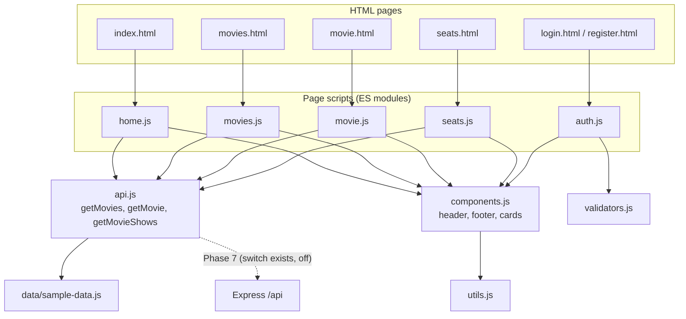
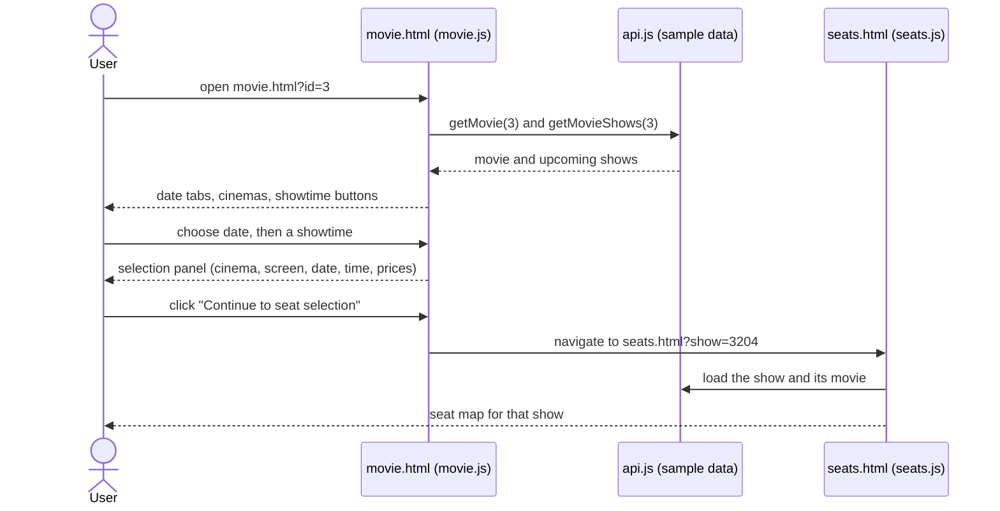
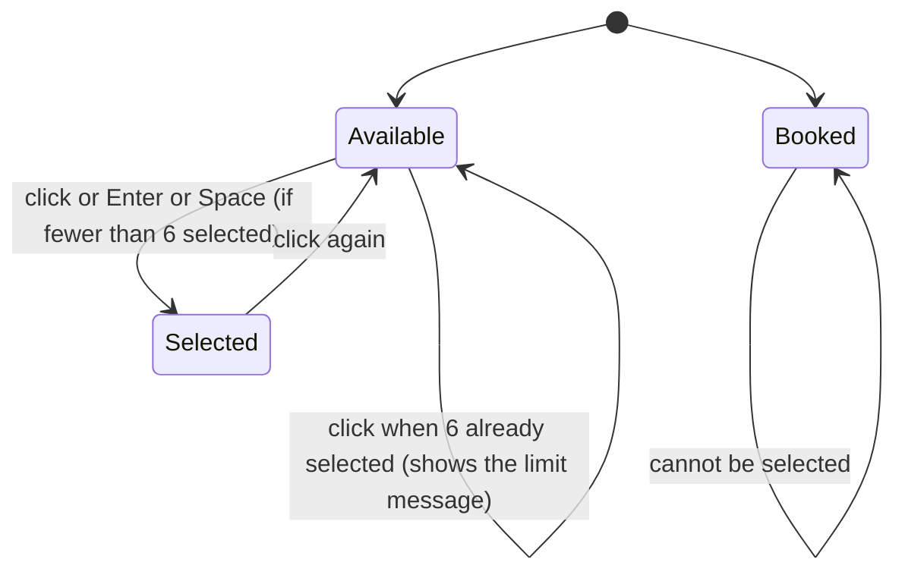

# BOOK_MY_SEAT: Phase 2 Report (Frontend Development)

| | |
|---|---|
| **Project** | BOOK_MY_SEAT |
| **Phase** | 2 of 8: frontend foundation (as built, including the follow-up frontend tasks) |
| **Report written** | 2026-10-31 |
| **Project root** | `E:\BOOK MY SEAT` (`frontend/` is the subject of this report) |

## 0. Scope, evidence and limits

The roadmap defines Phase 2 as *"frontend foundation with responsive pages, reusable CSS patterns, sample movie data, and working navigation."* In practice the frontend work continued in several approved follow-up tasks, all of which are described here and are all front-end only:

1. Foundation: design tokens, shared navbar and footer, Home, Movies, Movie details with showtime selection.
2. Login and Register pages with client-side validation (plus an email-validation fix).
3. Seat selection page structure, the seat layout, interactive seat selection, and dynamic pricing (first fixed prices, then cinema-specific prices from the show data).

**Evidence.** Every statement below was checked against the source files in the frontend folder, and code excerpts are copied verbatim from them by script (nothing retyped). Items that depend on observing a browser are labelled. **Testing claims are limited to what was actually run**; see Section 12.

> **Inspection note:** the author of this report inspected a working copy of `frontend/` and `backend/`, not `E:\BOOK MY SEAT` itself. Local edits you made after copying are not reflected.

**Important honesty points up front**

- The **entire frontend runs on sample data inside the browser**. It does **not** call the backend yet (`USE_SAMPLE_DATA = true` in `js/api.js`).
- "Booked" seats on the seat map are **simulated by a formula**, not read from any server.
- "Confirm booking" **does not book anything**.
- Login and Register are **UI and validation only**; no account or session exists.
- The **Netflix-inspired visual direction has not been started** (see Section 10).

---

## 1. Folder structure and file responsibilities

```text
frontend/
|-- assets/
|   `-- favicon.svg
|-- css/
|   |-- auth.css
|   |-- base.css
|   |-- components.css
|   |-- seats.css
|   `-- tokens.css
|-- js/
|   |-- data/
|   |   `-- sample-data.js
|   |-- pages/
|   |   |-- auth.js
|   |   |-- coming-soon.js
|   |   |-- home.js
|   |   |-- movie.js
|   |   |-- movies.js
|   |   `-- seats.js
|   |-- api.js
|   |-- components.js
|   |-- utils.js
|   `-- validators.js
|-- pages/
|   |-- coming-soon.html
|   |-- login.html
|   |-- movie.html
|   |-- movies.html
|   |-- register.html
|   `-- seats.html
|-- tests/
|   `-- validators.test.mjs
`-- index.html
```

| File | Responsibility |
|---|---|
| `index.html` | Home page: hero with search, seat-map decoration, featured movies, genre chips, "how booking works" |
| `pages/movies.html` | Movie listing with search, genre chips and language filter |
| `pages/movie.html` | Movie details container; filled by `js/pages/movie.js` |
| `pages/seats.html` | Seat selection page: show summary band, screen, seat grid container, legend, booking panel |
| `pages/login.html`, `pages/register.html` | Authentication forms (UI only) |
| `pages/coming-soon.html` | Placeholder for features not built yet (currently unreferenced by any link; kept as a safe target) |
| `css/tokens.css` | Design tokens (colours, fonts, spacing, radii, motion, layout) |
| `css/base.css` | Reset, typography, layout helpers, buttons, form fields, chips, skeleton and state blocks |
| `css/components.css` | Header, footer, hero, posters, movie cards, filters, movie details, showtime selector, summary card |
| `css/seats.css` | Seat page only: show summary band, screen, seat grid, seat states, legend, price lines, alert |
| `css/auth.css` | Login and register layout |
| `js/utils.js` | Pure helpers: HTML escaping, date, time, price and duration formatting, URL parameters, debounce |
| `js/api.js` | **The only data entry point**: `getMovies`, `getMovie`, `getMovieShows`, `ApiError` |
| `js/data/sample-data.js` | Temporary sample movies, cinemas and generated shows |
| `js/components.js` | Shared UI: header, footer, poster, movie card, skeleton and state blocks |
| `js/validators.js` | Pure form validation rules (no DOM) |
| `js/pages/*.js` | One script per page: `home`, `movies`, `movie`, `seats`, `auth` (login and register), `coming-soon` |
| `tests/validators.test.mjs` | Automated tests for the email rule (18 cases) |
| `assets/favicon.svg` | Logo mark used as favicon |

## 2. Architecture

### 2.1 How the pieces connect



Key conventions (all **[Source-verified]**):

- **ES modules.** Every page loads one `<script type="module">`. Browsers refuse ES modules from `file://`, so the pages **must be served over HTTP** (the Express backend does this, or any static server).
- **`data-root` and `data-nav`** on `<body>` tell shared code how to build links (`""` on the home page, `"../"` inside `pages/`) and which navbar link is active.
- **Shared header and footer** are injected by `initCommon()` into `<header id="site-header">` and `<footer id="site-footer">`.
- **Security by construction:** every value that comes from data goes through `escapeHtml()` before it is placed inside an HTML string.

```javascript
export function escapeHtml(value) {
  return String(value ?? '').replace(/[&<>"']/g, (ch) => ({
    '&': '&amp;', '<': '&lt;', '>': '&gt;', '"': '&quot;', "'": '&#39;',
  }[ch]));
}
```

- **Event delegation:** lists of buttons use one listener on the container (`closest(...)`) rather than one per button.
- **Loading, empty and error states** exist on every data page (skeleton blocks, "no results" message, and a retry button).

### 2.2 The API switch (how Phase 7 will connect the backend)

All pages get their data through `js/api.js`. It returns the same shapes the real API will, so pages need no changes later.

```javascript
// The only file that knows where data comes from.
// Page scripts call these functions. Each returns the "data" part of the Phase 1 API response
// and throws ApiError with the HTTP status the real API would use (400 invalid input, 404 not found).
//
// Phase 2: USE_SAMPLE_DATA = true  -> data comes from js/data/sample-data.js
// Phase 7: set it to false         -> the same functions call the Express API with fetch()

import { MOVIES, buildShows } from './data/sample-data.js';
import { toDateKey } from './utils.js';

const USE_SAMPLE_DATA = true;
const API_BASE = '/api';
```

```javascript
export async function getMovieShows(id, { date = '' } = {}) {
  const movieId = parseId(id);
  if (date && !/^\d{4}-\d{2}-\d{2}$/.test(date)) throw new ApiError('Invalid date', 400);
  if (!USE_SAMPLE_DATA) return request(`/movies/${movieId}/shows${date ? `?date=${date}` : ''}`);
  await wait();
  if (!MOVIES.some((m) => m.id === movieId)) throw new ApiError('Movie not found', 404);
  const now = new Date();
  return buildShows(now)
    .filter((s) => s.movie_id === movieId
      && new Date(s.start_time) > now
      && (!date || toDateKey(s.start_time) === date))
    .sort((a, b) => new Date(a.start_time) - new Date(b.start_time));
}
```

Behaviour worth knowing: with sample data, `getMovieShows` returns **only future shows**, earliest first, and throws `ApiError(400)` for a bad id or date and `ApiError(404)` for an unknown movie, mirroring what the backend does.

## 3. Design system

### 3.1 Tokens (`css/tokens.css`)

```css
  /* Burgundy */
  --c-burgundy-900: #2c0c15;
  --c-burgundy-800: #451020;
  --c-burgundy-700: #5e1629;
  --c-burgundy-600: #7b1d36;

  /* Charcoal */
  --c-charcoal-950: #111114;
  --c-charcoal-900: #1a1a1f;
  --c-charcoal-800: #25252c;
  --c-charcoal-700: #34343d;

  /* Red accent (600 = buttons on light, 400 = accents on dark) */
  --c-red-700: #a9243a;
  --c-red-600: #c42f47;
  --c-red-400: #ec6a7e;

  /* Light surfaces */
  --c-paper: #f6f3f1;
  --c-surface: #ffffff;
  --c-sand: #ece6e1;
  --c-line: #ddd5cf;

  /* Text */
  --c-ink: #211b1e;
  --c-ink-soft: #5d5357;
  --c-on-dark: #f6eee8;
  --c-on-dark-soft: #c9bcb6;
```

Fonts: **Gloock** (display headings) and **Figtree** (body), loaded from Google Fonts with Georgia and system-font fallbacks. They need an internet connection; offline, the fallbacks are used. Spacing, radii, shadows, motion durations and layout sizes are also tokens, so a redesign can be done largely by changing this one file.

### 3.2 CSS organisation

`tokens.css` then `base.css` then `components.css`, then a page-specific file (`seats.css` or `auth.css`) where needed. Seat classes are named `.cinema-seat...` on purpose, because the plain `.seat` classes in `components.css` belong to the decorative mini seat map on the home page hero.

---

## 4. A. Home page and movie browsing

### 4.1 Home page (`index.html`, `js/pages/home.js`)

Sections: hero (headline "Pick a film. Pick your seat.", a GET search form to `pages/movies.html?search=...`, a decorative seat map), **Featured movies**, **Browse by genre**, **How booking works** (four steps).

- **"Featured" has a precise meaning:** the four movies with the most recent `release_date`.

```javascript
    // "Featured" = the four most recent releases.
    const featured = [...movies].sort((a, b) => b.release_date.localeCompare(a.release_date)).slice(0, 4);
```

- The hero seat map is **decorative** (`aria-hidden`) and generated by JavaScript with a fixed pattern.

```javascript
const seatMap = document.getElementById('hero-seats');
if (seatMap) {
  let html = '';
  for (let row = 0; row < 5; row += 1) {
    for (let col = 0; col < 8; col += 1) {
      const picked = row === 3 && (col === 3 || col === 4);
      const taken = !picked && (row * 3 + col * 5) % 7 < 2;
      html += `<span class="seat${picked ? ' seat--picked' : taken ? ' seat--taken' : ''}"></span>`;
    }
  }
  seatMap.innerHTML = html;
}
```

### 4.2 Movie cards and posters (`js/components.js`)

A card links to `pages/movie.html?id=N`. Posters are drawn as a **gradient plus the title text**, and a real image (when `poster_url` is set) is layered on top. All sample movies have an empty `poster_url`, so gradients are what you see today. If an image fails to load, a document-level `error` listener (capture phase, because `error` events do not bubble) removes it and the gradient remains.

```javascript
export function posterHtml(movie, { decorative = false } = {}) {
  const variant = (Number(movie.id) % 6) + 1;
  const alt = decorative ? '' : `${escapeHtml(movie.title)} poster`;
  const img = movie.poster_url
    ? ``
    : '';
  return `<div class="poster poster--v${variant}">
      <span class="poster__fallback" aria-hidden="true">${escapeHtml(movie.title)}</span>
      ${img}
      <span class="poster__cert">${escapeHtml(movie.certificate)}</span>
    </div>`;
}
```

> **Not verified:** real remote poster images have never been tested, because none are configured. The fallback logic is straightforward but unproven with real URLs.

### 4.3 Movie listing, search and filtering (`pages/movies.html`, `js/pages/movies.js`)

Implemented: title **search** (debounced 250 ms), **genre** chips, **language** dropdown, a **Clear filters** button, a result count (announced to screen readers), and the filter state is **mirrored into the URL** (`?search=&genre=&language=`) so results can be bookmarked and the home page genre chips can deep-link. Filtering is delegated to `getMovies()`.

A small but important detail: responses can arrive out of order when the user types quickly, so each request gets a number and stale responses are ignored.

```javascript
async function runSearch() {
  const requestId = ++latestRequest;
  writeUrl();
  els.grid.setAttribute('aria-busy', 'true');
  if (!els.grid.querySelector('.movie-card')) els.grid.innerHTML = skeletonCards(8);
  try {
    const movies = await getMovies(state);
    if (requestId !== latestRequest) return;
    els.count.textContent = movies.length === 1 ? '1 movie found' : `${movies.length} movies found`;
    els.grid.innerHTML = movies.length
      ? movies.map((m) => movieCardHtml(m)).join('')
      : stateHtml({ title: 'No movies match your filters', message: 'Try a different title, or clear the filters to see everything that is playing.' });
  } catch (err) {
    if (requestId !== latestRequest) return;
    els.count.textContent = '';
    els.grid.innerHTML = stateHtml({ title: 'Could not load movies', message: 'Check your connection and try again.', retry: true });
  } finally {
    if (requestId === latestRequest) els.grid.removeAttribute('aria-busy');
  }
}
```

### 4.4 Movie details page (`pages/movie.html`, `js/pages/movie.js`)

Shows poster, title, certificate badge, duration, language, release date, genres, description, and the showtime selector (Section 5). Invalid or unknown ids (`?id=abc`, `?id=999`) show a "Movie not found" state with a link back to the movie list. The page title is updated to the movie name.

---

## 5. B. Showtime selection

### 5.1 User workflow



### 5.2 How it is implemented

- **Date selection:** date tabs are built from the dates that actually have shows (the sample data generates five days). Selecting a date clears the selected showtime.
- **Cinema selection:** there is **no separate "choose a cinema" control**. Shows of the selected date are **grouped by cinema**, and each cinema block lists its showtime buttons. Choosing a showtime therefore chooses the cinema, screen and time together.
- **Showtime buttons** show the time and "from ₹X" (the lowest category price of that show).

```javascript
function renderShows() {
  const list = $('show-list');
  if (!shows.length) {
    list.innerHTML = stateHtml({ title: 'No upcoming shows', message: 'There are no scheduled shows for this movie yet. Please check back later.' });
    return;
  }
  const byCinema = new Map();
  shows.filter((s) => toDateKey(s.start_time) === selectedDate).forEach((s) => {
    if (!byCinema.has(s.cinema.id)) byCinema.set(s.cinema.id, { cinema: s.cinema, items: [] });
    byCinema.get(s.cinema.id).items.push(s);
  });
  list.innerHTML = [...byCinema.values()].map(({ cinema, items }) => `
    <article class="cinema-block">
      <h3 class="cinema-block__name">${escapeHtml(cinema.name)}</h3>
      <p class="cinema-block__address">${escapeHtml(cinema.address)}, ${escapeHtml(cinema.city)}</p>
      <ul class="showtime-list">${items.map((s) => `
        <li><button type="button" class="showtime" data-show="${Number(s.id)}" aria-pressed="${s.id === selectedShowId}">
          <span class="showtime__time">${formatTime(s.start_time)}</span>
          <span class="showtime__price">from ${formatPrice(minPrice(s))}</span>
        </button></li>`).join('')}
      </ul>
    </article>`).join('');
}
```

- Selecting a date or showtime updates `aria-pressed` **in place** instead of re-rendering, so keyboard focus is not lost.

```javascript
mount.addEventListener('click', (e) => {
  if (e.target.closest('[data-retry]')) { load(); return; }
  const dateBtn = e.target.closest('.date-btn');
  if (dateBtn) {
    selectedDate = dateBtn.dataset.date;
    selectedShowId = null;
    syncDateButtons();
    renderShows();
    renderSummary();
    return;
  }
  const showBtn = e.target.closest('.showtime');
  if (showBtn) {
    selectedShowId = Number(showBtn.dataset.show);
    syncShowButtons();
    renderSummary();
  }
});
```

### 5.3 How the show id reaches the seat page

The selection panel's button links to the seat page with the show id in the URL:

```javascript
// Link to the seat selection page for the chosen show.
const seatSelectionHref = (showId) => `${root()}pages/seats.html?show=${Number(showId)}`;
```

The seat page reads `?show=ID`, loads the show and renders it (Section 6.1). **There is no login check before the seat page** (it is not implemented anywhere yet).

---

## 6. C. Seat selection system (`pages/seats.html`, `js/pages/seats.js`, `css/seats.css`)

### 6.1 Page flow and loading the show

On load, `load()` reads `?show=`, finds the show and its movie, loads seats and prices, then renders the show summary band (movie, cinema and screen, date, showtime, a "Change showtime" link), the seat map, and the booking panel. A missing, malformed or past show gives a "Show not found" message with a link to the movie list.

```javascript
// TEMPORARY (sample data): the API has no "get one show" call yet, and sample show ids start with the
// movie id (movieId * 1000 + ...). Phase 7 replaces this function with the real API call.
async function loadShow(rawId) {
  const showId = Number(rawId);
  if (!Number.isInteger(showId) || showId < 1) throw new ApiError('Invalid show id', 400);
  const movieId = Math.floor(showId / 1000);
  if (movieId < 1) throw new ApiError('Show not found', 404);
  const [movie, shows] = await Promise.all([getMovie(movieId), getMovieShows(movieId)]);
  const show = shows.find((s) => s.id === showId);
  if (!show) throw new ApiError('Show not found', 404);
  return { movie, show };
}
```

> **Known shortcut:** the API has no "get one show" call, so for sample data the seat page derives the movie id from the show id (`Math.floor(showId / 1000)`). This works only because the sample show ids are built as `movieId*1000 + ...`. It is marked `TEMPORARY` and is replaced in Phase 7.

### 6.2 The seat layout: 8 rows, 10 seats, central aisle

```javascript
const ROWS = ['A', 'B', 'C', 'D', 'E', 'F', 'G', 'H'];
const SEATS_PER_ROW = 10;
const AISLE_AFTER = 5; // the central aisle sits after seat 5
const MAX_SEATS = 6;
```

`loadSeats()` creates 80 seat objects: internal ids 1 to 80 (row A seats are 1 to 10, row B 11 to 20, and so on), each with `row_label`, `seat_number`, `category` and `status` (`AVAILABLE` or `BOOKED`).

```javascript
async function loadSeats(showId) {
  const seats = [];
  ROWS.forEach((row, r) => {
    for (let n = 1; n <= SEATS_PER_ROW; n += 1) {
      const id = r * SEATS_PER_ROW + n;
      seats.push({
        id, row_label: row, seat_number: n,
        category: SAMPLE_ROW_CATEGORIES[row],
        status: isSampleBooked(showId, id) ? 'BOOKED' : 'AVAILABLE',
      });
    }
  });
  return seats;
}
```

**The central aisle** is a CSS margin: seat 5 of every row gets the class `cinema-seat--aisle-after` (`margin-right: var(--seat-aisle)`).

**Row labels** appear on both sides of each row; seat numbers are inside the seats.

### 6.3 Sample booked-seat logic (this is simulated)

```javascript
function isSampleBooked(showId, seatId) {
  let h = Math.imul(showId, 2654435761) ^ Math.imul(seatId, 40503);
  h = Math.imul(h ^ (h >>> 15), 2246822519);
  return (h >>> 0) % 100 < 22;
}
```

This is a deterministic hash of (show id, seat id). It marks roughly 22% of seats as booked, and the pattern **differs from show to show but is identical every time you open the same show**. It does **not** reflect anything the user "booked", because nothing can be booked yet. Real availability is Phase 6 (`GET /api/shows/:id/seats`).

### 6.4 Seat states and appearance

| State | How it is represented | Appearance (`seats.css`) |
|---|---|---|
| Available | `<button>` with class `cinema-seat--available`, `aria-pressed="false"` | Light neutral fill with a dark border |
| Booked | `<button disabled>` with class `cinema-seat--booked` | Dark grey fill; not focusable, not clickable |
| Selected | class `cinema-seat--selected`, `aria-pressed="true"` | Red fill with burgundy border |

```css
.cinema-seat--available { background: var(--c-paper); border-color: var(--c-ink-soft); color: var(--c-ink); }
.cinema-seat--booked { background: var(--c-charcoal-700); border-color: var(--c-charcoal-700); color: var(--c-on-dark-soft); }
.cinema-seat--selected { background: var(--c-red-600); border-color: var(--c-burgundy-700); color: #fff; }
```

A legend under the map explains the three states. The legend swatches are plain `<span>`s that reuse the same classes, so the legend can never drift from the real seats.



### 6.5 Single source of truth for selection

Two separate collections, so booked data and user choices can never be mixed up:

```javascript
// ---------- State ----------
// selectedIds is the single source of truth for what the user has picked.
// bookedIds comes from the (sample) server data and is never changed by clicks.
const selectedIds = new Set();
let bookedIds = new Set();
let seatsById = new Map();
let buttonGrid = []; // buttons by [row][column], used for arrow-key movement
let panelEls = null; // elements inside the booking panel, created once by initPanel()
let prices = {}; // price per category for the current show, e.g. { STANDARD: 220, ... }
```

Everything shown in the booking panel is **derived** from `selectedIds` (see 6.8), so the panel cannot disagree with the map.

### 6.6 Click, deselect and the six-seat rule

```javascript
function toggleSeat(id) {
  if (!seatsById.has(id) || bookedIds.has(id)) return; // booked seats can never be selected
  if (selectedIds.has(id)) {
    selectedIds.delete(id);
  } else if (selectedIds.size >= MAX_SEATS) {
    showAlert(`You can select a maximum of ${MAX_SEATS} seats.`);
    return;
  } else {
    selectedIds.add(id);
  }
  clearAlert();
  syncSeatButton(id);
  renderPanel();
}
```

- Booked or unknown seats return immediately (and booked seats are also disabled buttons, so the browser does not even deliver the click).
- A 7th seat is refused with exactly **"You can select a maximum of 6 seats."** The message is a `role="alert"` paragraph placed above the map and made **sticky**, so it stays visible under the navbar while a long map scrolls (important on phones). It disappears when the selection next changes.
- One click listener on the grid handles all 80 seats (event delegation).

### 6.7 Keyboard navigation and accessibility

| Feature | How |
|---|---|
| Seats are native buttons | Enter and Space select or deselect without any custom code |
| One Tab stop for the whole map | **Roving tabindex:** only one seat has `tabindex="0"` (it follows focus), so Tab does not stop on 80 seats |
| Arrow keys | Left, Right, Up and Down move between free seats and **skip booked seats**; arrows do not scroll the page while inside the map |
| Screen reader labels | Each seat has an `aria-label` such as `Seat A1, Standard, ₹220` (booked: `Seat A1, Standard, booked`); rows are `role="group"` with `aria-label="Row A"` |
| State announcements | `aria-pressed` on seats; a hidden `role="status"` message announces e.g. "3 seats selected: A1, D2, G4. Total ₹1,060." |
| Limit message | `role="alert"` |
| Focus visibility | Global `:focus-visible` outline; seats lift above neighbours when focused |
| Reduced motion | `prefers-reduced-motion` switches animations and smooth scrolling off |

```javascript
// Arrow keys move between free seats; booked seats are skipped.
const ARROWS = { ArrowLeft: [0, -1], ArrowRight: [0, 1], ArrowUp: [-1, 0], ArrowDown: [1, 0] };
grid.addEventListener('keydown', (e) => {
  const step = ARROWS[e.key];
  const btn = e.target.closest('.cinema-seat');
  if (!step || !btn) return;
  e.preventDefault(); // stop the arrow key from scrolling the page
  let r = Number(btn.dataset.row) + step[0];
  let c = Number(btn.dataset.col) + step[1];
  while (r >= 0 && r < buttonGrid.length && c >= 0 && c < buttonGrid[r].length) {
    if (!buttonGrid[r][c].disabled) { buttonGrid[r][c].focus(); return; }
    r += step[0];
    c += step[1];
  }
});
```

> **Not verified:** behaviour with real screen readers (NVDA, JAWS, VoiceOver) has not been tested; the labels and roles follow standard practice but were not heard.

### 6.8 Booking summary panel

The panel's markup is generated by `initPanel()` once, and updated by `renderPanel()` on every change. It shows: an **empty state** ("No seats selected yet..."), the **number of seats selected**, one **line per selected seat** (seat id, category, price), the **total**, the **Confirm booking** button, and a "Demo project: no real payment is taken." note.

```javascript
function renderPanel() {
  const { items, count, total } = getSelection();
  panelEls.empty.hidden = count > 0;
  panelEls.details.hidden = count === 0;
  panelEls.count.textContent = String(count);
  panelEls.lines.innerHTML = items.map((item) => `
    <li class="price-line">
      <span class="price-line__seat">${escapeHtml(item.label)}</span>
      <span class="price-line__category">${escapeHtml(CATEGORY_LABELS[item.category])}</span>
      <span class="price-line__amount">${formatPrice(item.price)}</span>
    </li>`).join('');
  panelEls.total.textContent = formatPrice(total);
  panelEls.confirm.disabled = count === 0;
  panelEls.note.hidden = true;
  panelEls.announce.textContent = count === 0
    ? `No seats selected. Total ${formatPrice(0)}.`
    : `${count} ${count === 1 ? 'seat' : 'seats'} selected: ${items.map((i) => i.label).join(', ')}. Total ${formatPrice(total)}.`;
}
```

**Confirm booking behaviour (unchanged since it was first built):** the button is enabled only when at least one seat is selected. Clicking it shows *"Confirming a booking is not connected yet, so nothing was booked."* That is all. No request is sent, nothing is stored.

---

## 7. D. Dynamic pricing

### 7.1 Categories and prices

Seats have a **category by row**; each **show** has one **price per category**.

| Rows | Category |
|---|---|
| A, B, C | Standard |
| D, E, F | Premium |
| G, H | Recliner |

```javascript
const SAMPLE_ROW_CATEGORIES = {
  A: 'STANDARD', B: 'STANDARD', C: 'STANDARD',
  D: 'PREMIUM', E: 'PREMIUM', F: 'PREMIUM',
  G: 'RECLINER', H: 'RECLINER',
};
```

Cinema-specific prices (in INR; Standard / Premium / Recliner), defined in the sample data and **verified identical on both pages**:

| Cinema | Standard | Premium | Recliner |
|---|---|---|---|
| Aurora Cinemas | ₹220 | ₹320 | ₹520 |
| Lotus Multiplex | ₹260 | ₹380 | ₹620 |
| Starline Screens | ₹200 | ₹290 | ₹470 |

```javascript
const BASE_PRICES = { STANDARD: 220, PREMIUM: 320, RECLINER: 520 };
const PRICE_FACTOR = { 1: 1, 2: 1.2, 3: 0.9 };
const SLOTS = [[10, 30], [13, 45], [17, 0], [20, 15], [22, 45]];
```

(The sample generator multiplies base prices by a per-cinema factor and rounds to the nearest 10.)

### 7.2 How the seat page gets prices (and why the two pages always match)

```javascript
// Prices per category (INR) for this show, e.g. { STANDARD: 220, PREMIUM: 320, RECLINER: 520 }.
// Sample data: taken from the show object. Phase 7: the same values arrive from the API (show_prices).
async function loadPrices(show) {
  return { ...show.prices };
}
```

`loadPrices(show)` simply returns the selected **show's own** `prices`. The movie details page reads `show.prices` from the very same `getMovieShows()` function, so both pages display values from the same object by construction (there is no second price table to drift out of sync). The seat page also refuses to load if any seat's category has no price, instead of showing a wrong total.

> Earlier in development the seat page used one fixed price table (₹220/₹320/₹520). That caused a mismatch with the movie page for two of the three cinemas and was replaced by this approach (the "Option 2: cinema-specific pricing" decision).

### 7.3 Total price calculation

A single function converts the selection into line items and the total; nothing else calculates prices.

```javascript
function getSelection() {
  const items = [...selectedIds].sort((a, b) => a - b).map((id) => {
    const seat = seatsById.get(id);
    return { id, label: seatLabel(seat), category: seat.category, price: prices[seat.category] };
  });
  return { items, count: items.length, total: items.reduce((sum, item) => sum + item.price, 0) };
}
```

Prices are whole rupees. `formatPrice()` (`js/utils.js`) uses `Intl.NumberFormat('en-IN', INR)`, giving values like `₹1,060`. With no seats the total is `₹0`. Category headings in the seat map ("Standard ₹220 per seat", and so on) are drawn from the same prices.

> Prices and totals here are **for display only**. The server must recompute them from `show_prices` when bookings are implemented (Phase 6).

---

## 8. E. Authentication frontend

### 8.1 Pages

`pages/login.html` (email, password) and `pages/register.html` (full name, email, password, confirm password), sharing `js/pages/auth.js`. The form's `data-auth="login"` or `"register"` attribute selects the rules. Both use `method="post" action="#"` with `novalidate`: the `post` guarantees a password can never end up in the URL if JavaScript fails.

### 8.2 Validation rules (`js/validators.js`)

| Field | Rule |
|---|---|
| Name | 2 to 60 characters after trimming |
| Email | Anchored pattern that checks the **whole** input, plus an **ending check** (a two-letter country ending such as `in`, or one of a small allow-list: `com`, `org`, `net`, `edu`, `gov`, ...) |
| Login password | Must not be empty (the server will decide if it is correct) |
| New password | At least 8 characters and at most 72 **bytes** (bcrypt ignores anything past 72 bytes) |
| Confirm password | Must equal the password |

```javascript
// name@ + one or more domain labels, each followed by a dot + a letters-only ending (the last part).
// The pattern is anchored (^ ... $) so it checks the WHOLE input, and the ending captured in group 1
// is checked separately below. Labels may contain letters, digits and hyphens, but not start/end with a hyphen.
const EMAIL_PATTERN = /^[^\s@]+@(?:[A-Za-z0-9](?:[A-Za-z0-9-]*[A-Za-z0-9])?\.)+([A-Za-z]{2,})$/;

// A pattern alone cannot tell "com" from "comextra", so the last part must be a two-letter country ending
// (in, uk, us, ...) or one of these common endings. Trade-off: rarer real endings (.museum, .photography)
// are rejected. The server is still the final authority; real proof of an address is a confirmation email.
const COMMON_ENDINGS = new Set([
  'com', 'org', 'net', 'edu', 'gov', 'mil', 'int', 'info', 'biz', 'name', 'pro',
  'dev', 'app', 'online', 'site', 'tech', 'store', 'xyz', 'cloud', 'email', 'blog', 'shop', 'live', 'space', 'link', 'club',
]);
```

```javascript
export function validateEmail(value) {
  const email = value.trim();
  if (!email) return 'Enter your email address.';
  const message = 'Enter a valid email address, like name@example.com.';
  if (email.length > 254) return message;
  const match = EMAIL_PATTERN.exec(email);
  if (!match) return message;
  const ending = match[1].toLowerCase();
  return ending.length === 2 || COMMON_ENDINGS.has(ending) ? '' : message;
}
```

Why the allow-list: an earlier version accepted `anuja2170@gmail.comanuja21` because the final part accepted any characters. A pattern alone cannot tell `com` from `comextra`, so the ending is checked against a list. **Trade-off:** rarer real endings (`.museum`, `.photography`) are rejected. The server and a future confirmation email remain the real check.

### 8.3 Behaviour

Errors appear when a field loses focus and update as you type; changing the password re-checks the confirmation; submitting with errors focuses the first invalid field and sets `aria-invalid` and `aria-describedby`. A valid submit only shows a status message such as *"Login is not connected yet ... nothing was sent and you are not signed in."* The password is never logged or stored.

```javascript
form.addEventListener('submit', (event) => {
  event.preventDefault();
  status.hidden = true;
  fields.forEach((input) => touched.add(input.name));
  const results = fields.map((input) => [input, validateField(input)]);
  const firstInvalid = results.find(([, ok]) => !ok);
  if (firstInvalid) {
    firstInvalid[0].focus();
    return;
  }
  // Intentionally no fetch() here and the password is never logged or stored.
  status.textContent = mode === 'register'
    ? 'Your details look valid. Registration is not connected yet (the backend arrives in Phase 5), so nothing was sent or saved.'
    : 'Your details look valid. Login is not connected yet (the backend arrives in Phase 5), so nothing was sent and you are not signed in.';
  status.hidden = false;
});
```

### 8.4 Current status

**UI and client-side validation only.** No account is created, no request is sent, nobody is logged in, no token or cookie exists, and the pages are not protected. Server-side validation, hashing and JWT are Phase 5. The server must repeat every rule because client checks can be bypassed.

---

## 9. Navigation and shared UI

The header (`renderHeader()` in `js/components.js`) shows the logo, **Home** and **Movies** links (with `aria-current="page"` on the active one), and **Log in** and **Register** buttons that go to the two auth pages. Under 760 px it collapses into a menu button (`aria-expanded`, closes with Escape). The footer states that this is an academic project, that no real payments are taken, and that data is sample data. A "Skip to main content" link is the first focusable item on every page.

---

## 10. F. UI/UX

### 10.1 Netflix-inspired direction: current status

**Not implemented.** A Netflix-inspired redesign has been discussed as a *future* task, and you explicitly asked that it not be started. A search of all frontend and backend source for "netflix" finds nothing. The interface you see today follows the Phase 1 brief: **burgundy, charcoal and red, on light neutral surfaces**, with a dark navbar and dark hero bands.

### 10.2 What the current design uses

- **Typography:** Gloock for headings (the wordmark and display text), Figtree for body text (see Section 3).
- **Colours:** burgundy 900 to 600, charcoal 950 to 700, red 700, 600 and 400, paper `#f6f3f1`, white surfaces, line `#ddd5cf`, ink text. Red 600 is used for buttons because white text on it has a contrast ratio of about 5.5.
- **Interactions:** hover and focus colour changes, pressed (`aria-pressed`) states for chips, date tabs, showtimes and seats, sticky booking panel on desktop, sticky limit message.
- **Animations:** deliberately minimal. The only keyframe animation is the **shimmer** on loading skeletons (`css/base.css`). Everything else is short colour or shadow **transitions** (150 to 250 ms), and the mobile menu icon morphs into an X. There are **no entrance or scroll animations**.
- **Motion safety:** `prefers-reduced-motion: reduce` turns animations and smooth scrolling off.

### 10.3 Responsive behaviour (the real breakpoints)

| Breakpoint | File | What changes |
|---|---|---|
| max 760 px | `components.css` | Navbar becomes a menu button and a dropdown panel |
| max 820 px | `components.css` | Home hero stacks; mini seat map moves under the text |
| max 700 px | `components.css` | Movie filters become one column |
| max 640 px | `components.css` | Movie details stack (poster above text) |
| max 900 px / min 901 px | `components.css` | Showtime and seat layouts become a single column; the summary card is sticky only above 900 px |
| max 640 px | `seats.css` | Seats shrink (2 rem, tighter gaps) and a "Swipe sideways" hint appears |
| max 820 px | `auth.css` | The dark side panel on login and register is hidden |

The seat map is wrapped in a horizontally scrollable stage, and the screen sits inside that same scrolling area so they stay aligned. The seat buttons are about 32 px wide on phones, which is below the common 44 px touch-target recommendation (it meets the 24 px WCAG 2.2 minimum).

---

## 11. User workflows (end to end, as built)

1. **Browse:** Home, then Movies (search or filter), then a movie card.
2. **Choose a show:** on the movie page choose a date, then a showtime at a cinema.
3. **Choose seats:** "Continue to seat selection", then click up to 6 free seats; watch the panel total update.
4. **Try to confirm:** "Confirm booking" explains that booking is not connected yet.
5. **Auth screens:** Log in or Register show validation and a "not connected yet" message.

## 12. Testing performed and actual results

| What | How | Result | Where it lives |
|---|---|---|---|
| Email validation rules | Automated, `node --test` in `frontend/` | **18 of 18 passed** (run during this documentation task, on Node v22.22.2, Linux) | `frontend/tests/validators.test.mjs` (in the repository) |
| Frontend data layer, rendering, seat selection, pricing | During development, the real page scripts were run in a **simulated DOM (jsdom)** in a temporary folder, with scripted clicks and key presses: selecting and deselecting, booked seats, the 6-seat limit, totals for one seat per category, keyboard arrows, matching prices between the movie and seat pages for one show per cinema | All passed at the time | **Not in the repository.** These scripts were throw-away and cannot be re-run from the project. |
| Visual layout, responsiveness, real keyboard and mobile use | Manual browser testing | **Reported as completed by the project owner**; the author of this report could not observe it | n/a |

**Actual output of the automated frontend test run** (verbatim, durations removed):

```text
✔ valid: "anuja@gmail.com"
✔ valid: "anuja@gmail.com.in"
✔ valid: "name.surname+tag@mail.example.in"
✔ valid: "  anuja@gmail.com  "
✔ valid: "Anuja@Gmail.COM"
✔ invalid: "anuja@gmail.comextra"
✔ invalid: "anuja@gmail.com123"
✔ invalid: "anuja2170@gmail.comanuja21"
✔ invalid: "anuja@"
✔ invalid: "@gmail.com"
✔ invalid: "anuja@gmail"
✔ invalid: "anuja@gmail.c"
✔ invalid: "anuja@@gmail.com"
✔ invalid: "anu ja@gmail.com"
✔ invalid: "anuja@-gmail.com"
✔ invalid: "anuja@gmail..com"
✔ invalid: ""
✔ invalid: "aaaaaaaaaaaaaaaaaaaa..."
ℹ tests 18
ℹ suites 0
ℹ pass 18
ℹ fail 0
ℹ cancelled 0
ℹ skipped 0
ℹ todo 0
ℹ duration_ms <varies>
```

**What was not tested:** real screen readers; real remote poster images; any browser other than what the project owner used; Windows-specific behaviour of the frontend (it is plain browser code, so no differences are expected, but this was not observed); automated tests for the DOM code (none are in the repository).

## 13. Known limitations

1. All data is **sample data**; nothing is read from the backend yet.
2. **Seat availability is simulated** by `isSampleBooked()`. Booking a seat does nothing, so the same seats are "booked" on every visit.
3. **Confirm booking does not book.** There is no ticket, booking reference, My Bookings page or cancellation.
4. **Login and Register are UI only.** The seat page and "Confirm booking" are **not** protected by login.
5. **Selection is not remembered:** refreshing the seat page clears it (nothing is stored in the browser, by design).
6. The seat page finds a show's movie by **arithmetic on the show id**, valid only for the sample data.
7. The sample data exists **twice** (`frontend/js/data/sample-data.js` and `backend/data/sample-data.js`) and must be kept identical until Phase 4 removes both; there is no automated check for drift in the repository.
8. Sample shows are generated relative to "now", so which shows exist changes day to day; earlier show times of the current day disappear as they pass. Different cinemas can also appear to use the same screen at the same time (harmless sample data).
9. The Google Fonts stylesheet needs internet access.
10. **Stale wording in code comments and messages:** `js/pages/auth.js` begins with a comment saying "Phase 3 scope" (the login and register pages are Phase 2 frontend work); `js/pages/coming-soon.js` says "This Phase 2 build covers browsing movies and choosing a showtime", which is now out of date; `js/data/sample-data.js` says the API arrives in Phase 4 whereas the integration is Phase 7. Behaviour is unaffected.
11. `pages/seats.html` still contains static placeholder markup inside `#booking-panel` (title, "No seats selected yet", a disabled button). `seats.js` **replaces it entirely** at load, so that markup is dead code (it is only visible if JavaScript fails, and then the whole layout is hidden anyway).
12. `pages/coming-soon.html` is no longer linked from anywhere.
13. `request()` in `js/api.js` (the real network call) exists but has **never been executed by the frontend**; it was exercised only by a development-time contract test (see the Phase 3 report).

## 14. What a New Team Member Should Understand

1. **Run it over HTTP**, not by double-clicking the HTML files (ES modules). Easiest: start the backend (`npm run dev` in `backend/`) and open `http://localhost:3000/`.
2. **`js/api.js` is the seam.** Pages never touch sample data directly; they call `getMovies`, `getMovie`, `getMovieShows`. Phase 7 flips `USE_SAMPLE_DATA` to `false` and the real API answers instead.
3. **Seat page truths:** `selectedIds` is the *only* record of the user's choice, `bookedIds` comes from data, and the panel is always derived from `getSelection()`. If you add a feature, derive from these; do not copy state into the DOM.
4. **Prices come from the show**, never from a constant in the page. To change a cinema's prices change the data, not `seats.js`.
5. **Escape everything** with `escapeHtml()` before putting data into HTML strings.
6. **Accessibility is part of the behaviour,** not decoration: the roving tabindex, `aria-pressed`, labels and live regions are tested in the simulated DOM and should survive any redesign.
7. **The validators are meant to be mirrored on the server.** Client-side checks are convenience, not security.
8. **Before the Netflix-style redesign:** colours, fonts and spacing live in `css/tokens.css`; page structure lives in the HTML and the render functions in `js/pages/`. Keep class names and `id`s that the scripts use (`#seat-grid`, `#booking-panel`, `.cinema-seat`, `[data-seat-id]`) when restyling.

### Phase 7 integration points (so nothing is forgotten)

| Today | Phase 7 change |
|---|---|
| `USE_SAMPLE_DATA = true` in `api.js` | set to `false` |
| `loadShow()` in `seats.js` (derives movie id from show id) | replace with a real "get show" API call |
| `loadSeats()` and `isSampleBooked()` in `seats.js` | replace with `GET /api/shows/:id/seats` |
| `SAMPLE_ROW_CATEGORIES` in `seats.js` | seat categories come from the API |
| `loadPrices(show)` in `seats.js` | unchanged logic (uses `show.prices`) |
| "Confirm booking" note | call `POST /api/bookings` and handle `409` (seat taken) |

## 15. Project status at the end of Phase 2 (as verified today)

**Completed work**
- Responsive Home, Movies, Movie details with showtime selection; shared header and footer; design tokens.
- Login and Register pages with client-side validation (email rule fixed and tested).
- Seat selection page: 8 by 10 layout with aisle, three seat states and legend, select and deselect, six-seat limit, keyboard navigation, booking panel, cinema-specific dynamic pricing with correct totals.

**Partially completed work**
- API integration: the switch and the real request helper exist but are off and unproven in the browser.
- Seat availability and "booked" seats: simulated.
- Authentication screens: UI only.

**Pending work**
- Confirm booking, ticket and booking reference, My Bookings, cancellation, logout, route protection, admin screens.
- The Netflix-inspired redesign (not started).
- Real poster images; real screen-reader testing; automated DOM tests inside the repository.

**Known limitations:** see Section 13.

**Dependencies on future phases:** real seats and bookings need Phases 4 and 6; login needs Phase 5; replacing sample data needs Phase 7.
