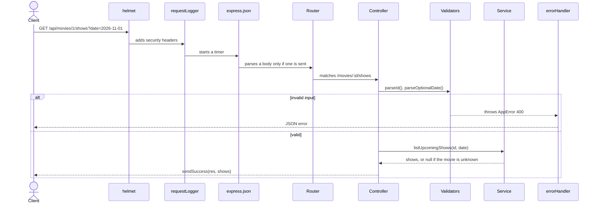

# BOOK_MY_SEAT: Phase 3 Report (Backend Development)

| | |
|---|---|
| **Project** | BOOK_MY_SEAT |
| **Phase** | 3 of 8: Node.js and Express setup, routes, controllers, middleware, configuration, initial API tests |
| **Report written** | 2026-10-31 |
| **Project root** | `E:\BOOK MY SEAT` (`backend/` is the subject of this report) |

## 0. Scope, evidence and limits

Phase 3 builds the **server side skeleton**: an Express application that serves the existing frontend and a small, read-only JSON API, backed by **temporary in-memory sample data**. It deliberately contains **no database, no authentication, no bookings**.

**Evidence.** Everything here was checked against the backend source files. Code excerpts, the response examples and the test output are copied **verbatim** from the real files, from responses captured from the running server (2026-10-31), and from a real test run, by script. Nothing is retyped.

> **Inspection and verification note:** the author of this report inspected a working copy of the project, not `E:\BOOK MY SEAT` itself. The author's commands and automated tests documented below were run on Linux with **Node v22.22.2 and npm 10.9.7**. Separately, the project owner has now reported successfully verifying Phase 3 on **Windows with Node v22.21.0 and npm 10.9.4**. The owner's reported results are recorded separately in Section 5.4; they are not presented as tests independently observed or run by the report author.

---

## 1. A. Server architecture

### 1.1 What was built

```text
Node.js process  (server.js)
  `-- Express application  (app.js)
        |-- security headers (helmet)
        |-- request logger (development only)
        |-- JSON body parser (10 KB limit)
        |-- /api  -->  routes  -->  controllers  -->  services  -->  sample data
        |-- static files  <--  ../frontend   (the website itself)
        |-- 404 handlers
        `-- central error handler
```

### 1.2 Entry points

`app.js` **builds** the Express application and exports it (it does not listen on a port). Keeping that separate lets the tests start the same app on a random free port. `server.js` is the only file that **starts listening**.

```javascript
// Builds the Express application (without starting it, so tests can start it on any port).
// Request flow:  security headers -> logger -> JSON body parser -> /api routes -> frontend files -> 404 -> error handler

const express = require('express');
const helmet = require('helmet');
const { config } = require('./config/env');
const apiRoutes = require('./routes');
const requestLogger = require('./middleware/requestLogger');
const { apiNotFound, pageNotFound } = require('./middleware/notFound');
const errorHandler = require('./middleware/errorHandler');

const app = express();

// Secure HTTP headers. The frontend loads Google Fonts and may show poster images from https URLs, so image
// sources allow https. "upgrade-insecure-requests" is switched off because it breaks plain http://localhost.
app.use(helmet({
  contentSecurityPolicy: {
    useDefaults: true,
    directives: {
      'img-src': ["'self'", 'data:', 'https:'],
      'upgrade-insecure-requests': null,
    },
  },
}));

if (!config.isTest) app.use(requestLogger);

app.use(express.json({ limit: '10kb' }));

app.use('/api', apiRoutes);
app.use('/api', apiNotFound);

// Single-origin design: Express also serves the frontend folder, so the browser talks to one address.
app.use(express.static(config.frontendDir));
app.use(pageNotFound);

app.use(errorHandler);

module.exports = app;
```

Notes on the order (it matters in Express, because middleware runs in the order it is registered):

1. **helmet** first, so every response, including errors and static files, gets security headers.
2. **requestLogger** only when not in test mode.
3. **`express.json`** parses JSON request bodies (limit 10 KB).
4. **`/api` routes**, then **`apiNotFound`**, so an unknown `/api/...` URL gets a JSON 404 and never falls through to the static file handler.
5. **`express.static(frontendDir)`** serves the website.
6. **`pageNotFound`** is the plain 404 for everything else.
7. **`errorHandler`** last: Express treats a function with four parameters as an error handler.

```javascript
// Starts the HTTP server. Run with "npm start" (or "npm run dev" to restart automatically on file changes).

const fs = require('node:fs');
const app = require('./app');
const { config } = require('./config/env');

if (!fs.existsSync(config.frontendDir)) {
  console.warn(`Warning: frontend folder not found at ${config.frontendDir}. The API will work, but pages will not load.`);
}

const server = app.listen(config.port);

server.on('listening', () => {
  const { port } = server.address();
  console.log(`BOOK_MY_SEAT is running (${config.nodeEnv})`);
  console.log(`  Website:      http://localhost:${port}/`);
  console.log(`  API health:   http://localhost:${port}/api/health`);
  console.log('Press Ctrl+C to stop.');
});

server.on('error', (err) => {
  if (err.code === 'EADDRINUSE') {
    console.error(`Port ${config.port} is already in use. Close the other program or change PORT in .env.`);
  } else {
    console.error(err);
  }
  process.exit(1);
});

function shutdown() {
  console.log('\nShutting down...');
  server.close(() => process.exit(0));
  setTimeout(() => process.exit(1), 5000).unref(); // do not hang if a connection stays open
}
process.on('SIGINT', shutdown);
process.on('SIGTERM', shutdown);
```

### 1.3 How the backend serves the frontend (single origin)

`express.static(config.frontendDir)` serves the folder `..\frontend` relative to `backend/` (`config/env.js` builds this with `path.join(__dirname, '..', '..', 'frontend')`). Requesting `/` serves `frontend/index.html`; `/pages/seats.html?show=1101`, `/css/tokens.css` and `/js/api.js` work the same way. JavaScript files are sent as `text/javascript`, which browsers require for ES modules (a test checks this). Because the website and API share one address, **no CORS configuration is needed**. If the frontend folder is missing, `server.js` prints a warning and the API still works.

### 1.4 Startup and configuration

```javascript
// Central configuration. Reads environment variables (from a local .env file if present) and validates them
// once at start-up, so a bad value fails immediately with a clear message instead of causing odd bugs later.

const path = require('node:path');
require('dotenv').config({ path: path.join(__dirname, '..', '.env'), quiet: true });

const ALLOWED_ENVS = ['development', 'test', 'production'];

function loadConfig(env = process.env) {
  const nodeEnv = env.NODE_ENV || 'development';
  if (!ALLOWED_ENVS.includes(nodeEnv)) {
    throw new Error(`NODE_ENV must be one of ${ALLOWED_ENVS.join(', ')} (got "${nodeEnv}")`);
  }

  const rawPort = env.PORT === undefined || env.PORT === '' ? '3000' : env.PORT;
  const port = Number(rawPort);
  if (!/^\d+$/.test(String(rawPort)) || !Number.isInteger(port) || port > 65535) {
    throw new Error(`PORT must be a whole number between 0 and 65535 (got "${rawPort}")`);
  }

  return {
    nodeEnv,
    port,
    isProduction: nodeEnv === 'production',
    isTest: nodeEnv === 'test',
    // The frontend folder sits next to the backend folder and is served by Express (single-origin design).
    frontendDir: path.join(__dirname, '..', '..', 'frontend'),
  };
}

module.exports = { loadConfig, config: loadConfig() };
```

- Configuration is read from environment variables, optionally from `backend/.env` (path anchored to the backend folder, so it works whatever directory you start from). `quiet: true` stops dotenv printing a banner.
- It is **validated once at start-up**: an invalid `PORT` or `NODE_ENV` makes the process exit immediately with a clear message instead of failing mysteriously later.
- `.env.example` documents the variables; the real `.env` is ignored by Git (`backend/.gitignore`).

```.example
# Copy this file to ".env" and adjust. ".env" is ignored by Git and must never be committed.
NODE_ENV=development
PORT=3000

# Added in later phases (do not fill in yet):
# DB_HOST=localhost
# DB_USER=
# DB_PASSWORD=
# DB_NAME=book_my_seat
# JWT_SECRET=
```

Scripts in `package.json`:

```json
{
  "name": "book-my-seat-backend",
  "version": "0.3.0",
  "description": "BOOK_MY_SEAT backend: Express REST API (Phase 3 - setup, routes, controllers, middleware)",
  "private": true,
  "main": "server.js",
  "scripts": {
    "start": "node server.js",
    "dev": "node --watch server.js",
    "test": "node --test"
  },
  "engines": {
    "node": ">=20.0.0"
  },
  "dependencies": {
    "dotenv": "18.0.7",
    "express": "5.3.0",
    "helmet": "8.3.0"
  }
}
```

| Command | Effect |
|---|---|
| `npm start` | `node server.js` |
| `npm run dev` | `node --watch server.js` (restarts on file changes; replaces `nodemon`) |
| `npm test` | `node --test` (runs `tests/api.test.js`) |

Behaviour verified by running the real server: it prints the website and health URLs; a port already in use gives "Port N is already in use. Close the other program or change PORT in .env." and exit code 1; an invalid `PORT` or `NODE_ENV` makes it exit with the validation message (as a stack trace that contains the message); Ctrl+C (SIGINT) or SIGTERM closes the server gracefully and exits (measured at about 1.3 s with one keep-alive connection; a 5 s safety timer prevents hanging).

---

## 2. B. REST API

All responses are JSON in one of two shapes (produced by `utils/response.js` and `middleware/errorHandler.js`):

```json
{ "success": true,  "data": ... }
{ "success": false, "error": { "message": "..." } }
```

**All four endpoints are `GET` and require no authentication.** (The Phase 1 contract also lists auth, bookings and seat endpoints; they do **not** exist yet.)

Mounting, from `routes/index.js` and `routes/movie.routes.js`:

```javascript
// Every API route is mounted here under /api (see app.js).
// Auth, bookings and seat availability routes are added in later phases.

const express = require('express');
const healthController = require('../controllers/health.controller');
const movieRoutes = require('./movie.routes');

const router = express.Router();

router.get('/health', healthController.check);
router.use('/movies', movieRoutes);

module.exports = router;
```

```javascript
const express = require('express');
const movieController = require('../controllers/movie.controller');

const router = express.Router();

router.get('/', movieController.listMovies);
router.get('/:id', movieController.getMovie);
router.get('/:id/shows', movieController.listMovieShows);

module.exports = router;
```

### 2.1 `GET /api/health`

| | |
|---|---|
| **Purpose** | Check that the server is running (also useful to a monitor later) |
| **Parameters** | none |
| **Status codes** | `200` |
| **Controller** | `health.controller.js`, `check` (no service involved) |

Example request: `GET /api/health`. Real response (captured 2026-10-31):

```json
{
  "success": true,
  "data": {
    "status": "ok",
    "uptime_seconds": 2,
    "timestamp": "2026-10-31T06:12:57.869Z"
  }
}
```

### 2.2 `GET /api/movies`

| | |
|---|---|
| **Purpose** | List movies, optionally filtered |
| **Query parameters (all optional)** | `search` (title contains, case-insensitive, max 100 characters), `genre` (exact genre, case-insensitive, max 50), `language` (exact language, case-insensitive, max 50). Filters combine with AND. |
| **Status codes** | `200` (an empty list is still `200`); `400` if a parameter is repeated (`?search=a&search=b`) or longer than its limit |
| **Controller / service** | `movie.controller.js` `listMovies`; `movie.service.js` `listMovies` |

Example request: `GET /api/movies?language=Tamil` (note: Tamil is a **language**, not a genre; `?genre=Tamil` returns an empty list). Real response:

```json
{
  "success": true,
  "data": [
    {
      "id": 6,
      "title": "Kaveri Express",
      "language": "Tamil",
      "duration_min": 143,
      "certificate": "UA",
      "release_date": "2026-10-18",
      "poster_url": "",
      "genres": [
        "Adventure",
        "Drama"
      ],
      "description": "A school teacher and a retired engine driver race to deliver a village's harvest on a decommissioned train before the monsoon floods the tracks."
    }
  ]
}
```

`GET /api/movies` returns all 9 sample movies, for example (first item shown, the list continues):

```json
{
  "success": true,
  "data": [
    {
      "id": 1,
      "title": "Midnight Monsoon",
      "language": "Hindi",
      "duration_min": 138,
      "certificate": "UA",
      "release_date": "2026-10-09",
      "poster_url": "",
      "genres": [
        "Drama",
        "Romance"
      ],
      "description": "Two strangers sharing a stalled Mumbai local during a night of record rain discover they are connected by a letter neither of them sent."
    }
  ]
}
```

`GET /api/movies?search=monsoon` returned 1 movie ("Midnight Monsoon") when captured. A search such as `?search=' OR 1=1 --` is treated as plain text and returns an empty list (a test checks this).

### 2.3 `GET /api/movies/:id`

| | |
|---|---|
| **Purpose** | One movie by id |
| **Path parameter** | `id`: a positive whole number of at most 10 digits (regular expression `^[1-9]\d{0,9}$`) |
| **Status codes** | `200`; `400` (id is not a positive whole number: `abc`, `0`, `-1`, `1.5`, `1e3`, very long numbers); `404` (valid id, no such movie) |
| **Controller / service** | `movie.controller.js` `getMovie`; `movie.service.js` `getMovieById` |

Example request `GET /api/movies/1`:

```json
{
  "success": true,
  "data": {
    "id": 1,
    "title": "Midnight Monsoon",
    "language": "Hindi",
    "duration_min": 138,
    "certificate": "UA",
    "release_date": "2026-10-09",
    "poster_url": "",
    "genres": [
      "Drama",
      "Romance"
    ],
    "description": "Two strangers sharing a stalled Mumbai local during a night of record rain discover they are connected by a letter neither of them sent."
  }
}
```

Example errors (`GET /api/movies/abc` gives `400`, `GET /api/movies/999` gives `404`):

```json
{
  "success": false,
  "error": {
    "message": "id must be a positive whole number."
  }
}
```

```json
{
  "success": false,
  "error": {
    "message": "Movie not found."
  }
}
```

### 2.4 `GET /api/movies/:id/shows`

| | |
|---|---|
| **Purpose** | Upcoming shows of one movie, earliest first, with cinema, screen and the prices of that show |
| **Path parameter** | `id` as above |
| **Query parameter (optional)** | `date=YYYY-MM-DD`: only shows on that day. Must be a **real** calendar date (`2026-02-31` is rejected). Repeating it is rejected. |
| **Status codes** | `200` (an empty array if the day has no shows); `400` (bad id, malformed or impossible date, repeated `date`); `404` (no such movie) |
| **Controller / service** | `movie.controller.js` `listMovieShows`; `movie.service.js` `listUpcomingShows` (returns `null` for an unknown movie, which the controller turns into `404`) |

Only **future** shows are returned. Example request `GET /api/movies/1/shows`, first item shown (the array continued with 30 shows when captured):

```json
{
  "success": true,
  "data": [
    {
      "id": 1000,
      "movie_id": 1,
      "start_time": "2026-10-31T10:30:00.000Z",
      "status": "SCHEDULED",
      "cinema": {
        "id": 2,
        "name": "Lotus Multiplex",
        "city": "New Delhi",
        "address": "Barakhamba Road, Connaught Place"
      },
      "screen": {
        "id": 22,
        "name": "Screen 2"
      },
      "prices": {
        "STANDARD": 260,
        "PREMIUM": 380,
        "RECLINER": 620
      }
    }
  ]
}
```

How to read the example: `id` encodes the movie, day offset, cinema index and time slot (`movie*1000 + day*100 + cinema*10 + slot`, sample data only). `prices` are in INR for Standard, Premium and Recliner and are **cinema-specific**: Aurora 220/320/520, Lotus 260/380/620, Starline 200/290/470 (a test verifies this for every show of every movie). `start_time` is an ISO UTC timestamp; the sample generator builds times in the **server's local time zone**, so the clock time you see depends on where the server runs (the captured example comes from a UTC machine; an Indian machine produces the same local times, shifted to UTC in the string). `GET /api/movies/1/shows?date=2026-11-01` returned 6 shows when captured.

### 2.5 Other responses you will see

```json
{
  "success": false,
  "error": {
    "message": "API route not found."
  }
}
```

(an unknown `/api/...` path, or a method a route does not support, for example `POST /api/movies`: the API returns `404` rather than `405`, which is acceptable for now);

```json
{
  "success": false,
  "error": {
    "message": "date is not a real calendar date."
  }
}
```

```json
{
  "success": false,
  "error": {
    "message": "The request body is not valid JSON."
  }
}
```

(an invalid JSON body, for example `POST` with `{"broken": `). An oversized body (over 10 KB) returns `413`.

---

## 3. C. Backend architecture

### 3.1 Folder structure

```text
backend/
|-- config/
|   `-- env.js
|-- controllers/
|   |-- health.controller.js
|   `-- movie.controller.js
|-- data/
|   `-- sample-data.js
|-- middleware/
|   |-- errorHandler.js
|   |-- notFound.js
|   `-- requestLogger.js
|-- routes/
|   |-- index.js
|   `-- movie.routes.js
|-- services/
|   `-- movie.service.js
|-- tests/
|   `-- api.test.js
|-- utils/
|   |-- AppError.js
|   `-- response.js
|-- validators/
|   `-- params.js
|-- .env.example
|-- .gitignore
|-- app.js
|-- package-lock.json
|-- package.json
`-- server.js
```

### 3.2 Layers and responsibilities

| Layer | File(s) | Responsibility | Must not |
|---|---|---|---|
| Routes | `routes/` | Map method and URL to a controller function | contain logic |
| Controllers | `controllers/` | Read and **validate** the request, call a service, send the response | contain business rules or (later) SQL |
| Services | `services/movie.service.js` | Business logic and data access; the only layer that will change in Phase 4 | know about `req` or `res` |
| Validators | `validators/params.js` | Reject bad input with `AppError(400)` | trust anything from the client |
| Middleware | `middleware/` | Cross-cutting: logging, 404 handling, error handling (helmet and body parsing are registered in `app.js`) | |
| Utilities | `utils/AppError.js`, `utils/response.js` | The deliberate-error class and the success response shape | |
| Configuration | `config/env.js` | Environment variables, validated | |
| Sample data | `data/sample-data.js` | **Temporary** movies, cinemas, prices and show generator | stay after Phase 4 |

### 3.3 The request-response lifecycle



### 3.4 The code, layer by layer

**Controller** (HTTP only; Express 5 forwards a thrown error or rejected promise from an `async` function to the error handler automatically, so there is no `try/catch` boilerplate):

```javascript
// Controllers handle HTTP only: read and validate the request, call a service, send the response.
// They contain no business rules and no SQL. Express 5 forwards errors from async functions automatically.

const movieService = require('../services/movie.service');
const AppError = require('../utils/AppError');
const { sendSuccess } = require('../utils/response');
const { parseId, parseOptionalText, parseOptionalDate } = require('../validators/params');

// GET /api/movies?search=&genre=&language=
async function listMovies(req, res) {
  const filters = {
    search: parseOptionalText(req.query.search, 'search'),
    genre: parseOptionalText(req.query.genre, 'genre', 50),
    language: parseOptionalText(req.query.language, 'language', 50),
  };
  sendSuccess(res, await movieService.listMovies(filters));
}

// GET /api/movies/:id
async function getMovie(req, res) {
  const movie = await movieService.getMovieById(parseId(req.params.id));
  if (!movie) throw new AppError(404, 'Movie not found.');
  sendSuccess(res, movie);
}

// GET /api/movies/:id/shows?date=YYYY-MM-DD
async function listMovieShows(req, res) {
  const movieId = parseId(req.params.id);
  const date = parseOptionalDate(req.query.date);
  const shows = await movieService.listUpcomingShows(movieId, { date });
  if (!shows) throw new AppError(404, 'Movie not found.');
  sendSuccess(res, shows);
}

module.exports = { listMovies, getMovie, listMovieShows };
```

**Service** (async with fixed signatures so MySQL can replace the sample data in Phase 4 without touching controllers or routes; it returns copies via `structuredClone` so callers cannot mutate the shared data):

```javascript
// Business logic for movies and shows. Controllers call these functions and know nothing about where the data
// lives. Phase 4 replaces the bodies with MySQL queries; the function names, arguments and return shapes stay.
// All functions are async because database calls will be.

const { MOVIES, buildShows } = require('../data/sample-data');

// "YYYY-MM-DD" of a timestamp in the server's local time (sample data only; the database phase uses UTC).
function dayKey(dateLike) {
  const d = new Date(dateLike);
  const pad = (n) => String(n).padStart(2, '0');
  return `${d.getFullYear()}-${pad(d.getMonth() + 1)}-${pad(d.getDate())}`;
}

async function listMovies({ search = '', genre = '', language = '' } = {}) {
  const term = search.toLowerCase();
  const wantedGenre = genre.toLowerCase();
  const wantedLanguage = language.toLowerCase();
  return structuredClone(MOVIES.filter((m) =>
    (!term || m.title.toLowerCase().includes(term))
    && (!wantedGenre || m.genres.some((g) => g.toLowerCase() === wantedGenre))
    && (!wantedLanguage || m.language.toLowerCase() === wantedLanguage)));
}

/** The movie, or null when it does not exist. */
async function getMovieById(id) {
  const movie = MOVIES.find((m) => m.id === id);
  return movie ? structuredClone(movie) : null;
}

/** Upcoming shows (earliest first), optionally for one day. Returns null when the movie does not exist. */
async function listUpcomingShows(movieId, { date = '' } = {}) {
  if (!MOVIES.some((m) => m.id === movieId)) return null;
  const now = new Date();
  return buildShows(now)
    .filter((s) => s.movie_id === movieId
      && new Date(s.start_time) > now
      && (!date || dayKey(s.start_time) === date))
    .sort((a, b) => new Date(a.start_time) - new Date(b.start_time));
}

module.exports = { listMovies, getMovieById, listUpcomingShows };
```

**Validators:**

```javascript
// Input validators for route parameters and query strings. Each one either returns a clean value or throws
// AppError(400). Never trust req.params / req.query: they are plain strings (or arrays) typed by the client.

const AppError = require('../utils/AppError');

/** A positive whole number such as "7" (not "abc", "0", "-1", "1.5" or "1e3"). */
function parseId(value, name = 'id') {
  if (typeof value !== 'string' || !/^[1-9]\d{0,9}$/.test(value)) {
    throw new AppError(400, `${name} must be a positive whole number.`);
  }
  return Number(value);
}

/** Optional text filter such as ?search=. Missing means "no filter". Arrays (?a=1&a=2) are rejected. */
function parseOptionalText(value, name, maxLength = 100) {
  if (value === undefined) return '';
  if (typeof value !== 'string') throw new AppError(400, `${name} must be a single text value.`);
  const text = value.trim();
  if (text.length > maxLength) throw new AppError(400, `${name} must be at most ${maxLength} characters.`);
  return text;
}

/** Optional calendar date "YYYY-MM-DD" that really exists (rejects 2026-02-31). Returns '' when missing. */
function parseOptionalDate(value, name = 'date') {
  if (value === undefined || value === '') return '';
  const match = typeof value === 'string' ? /^(\d{4})-(\d{2})-(\d{2})$/.exec(value) : null;
  if (!match) throw new AppError(400, `${name} must be in the format YYYY-MM-DD.`);
  const [year, month, day] = [Number(match[1]), Number(match[2]), Number(match[3])];
  const check = new Date(Date.UTC(year, month - 1, day));
  if (check.getUTCFullYear() !== year || check.getUTCMonth() !== month - 1 || check.getUTCDate() !== day) {
    throw new AppError(400, `${name} is not a real calendar date.`);
  }
  return value;
}

module.exports = { parseId, parseOptionalText, parseOptionalDate };
```

**Utilities:**

```javascript
// An error we throw on purpose, with the HTTP status the client should receive.
// Anything that is NOT an AppError is treated as an unexpected bug (500) by the error handler.

class AppError extends Error {
  constructor(status, message, details = null) {
    super(message);
    this.name = 'AppError';
    this.status = status;
    this.details = details;
  }
}

module.exports = AppError;
```

```javascript
// One place that defines the success response shape: { "success": true, "data": ... }
// (errors use { "success": false, "error": { "message": ... } } and are produced by middleware/errorHandler.js)

function sendSuccess(res, data, status = 200) {
  return res.status(status).json({ success: true, data });
}

module.exports = { sendSuccess };
```

**Health controller:**

```javascript
const { sendSuccess } = require('../utils/response');

// GET /api/health: lets you (and later a monitor) check that the server is running.
function check(req, res) {
  sendSuccess(res, {
    status: 'ok',
    uptime_seconds: Math.round(process.uptime()),
    timestamp: new Date().toISOString(),
  });
}

module.exports = { check };
```

**Sample data** (temporary; mirrors `frontend/js/data/sample-data.js`):

```javascript
// Price per category (INR) for each cinema. Standard / Premium / Recliner.
const CINEMA_PRICES = {
  1: { STANDARD: 220, PREMIUM: 320, RECLINER: 520 }, // Aurora
  2: { STANDARD: 260, PREMIUM: 380, RECLINER: 620 }, // Lotus
  3: { STANDARD: 200, PREMIUM: 290, RECLINER: 470 }, // Starline
};
```

```javascript
function buildShows(now = new Date()) {
  const shows = [];
  for (const movie of MOVIES) {
    for (let day = 0; day < 5; day += 1) {
      for (let c = 0; c < 2; c += 1) {
        const seed = movie.id + day + c;
        const cinema = CINEMAS[seed % CINEMAS.length];
        const slotIdx = [seed % 5, (seed + 2) % 5, (seed + 4) % 5].sort((a, b) => a - b);
        for (const s of slotIdx) {
          const [hh, mm] = SLOTS[s];
          const start = new Date(now.getFullYear(), now.getMonth(), now.getDate() + day, hh, mm);
          const screenNo = (movie.id % 3) + 1;
          shows.push({
            id: movie.id * 1000 + day * 100 + c * 10 + s,
            movie_id: movie.id,
            start_time: start.toISOString(),
            status: 'SCHEDULED',
            cinema: { ...cinema },
            screen: { id: cinema.id * 10 + screenNo, name: `Screen ${screenNo}` },
            prices: { ...CINEMA_PRICES[cinema.id] },
          });
        }
      }
    }
  }
  return shows;
}
```

The nine movies, three cinemas and the show generator have **identical content** to the frontend copy: on 2026-10-31 a comparison of both files' movies, cinemas and generated shows (for two different "now" dates) found them identical. There is no automated check for this in the repository, so keep them in step until Phase 4 deletes both.

---

## 4. D. Security and error handling

### 4.1 Helmet (secure HTTP headers)

`helmet` adds a set of protective headers. The most important, **Content-Security-Policy (CSP)**, tells the browser where scripts, styles, images and fonts may come from. The defaults were kept except two deliberate changes in `app.js`: **`img-src` additionally allows `https:`** (movie posters may later come from remote HTTPS URLs) and **`upgrade-insecure-requests` is switched off** (it makes browsers rewrite `http://localhost` requests to HTTPS and breaks local development). Real response headers (captured from `GET /api/health`):

```http
HTTP/1.1 200 OK

Content-Security-Policy: default-src 'self';base-uri 'self';font-src 'self' https: data:;form-action 'self';frame-ancestors 'self';img-src 'self' data: https:;object-src 'none';script-src 'self';script-src-attr 'none';style-src 'self' https: 'unsafe-inline'

Cross-Origin-Opener-Policy: same-origin

Cross-Origin-Resource-Policy: same-origin

Origin-Agent-Cluster: ?1

Referrer-Policy: no-referrer

Strict-Transport-Security: max-age=31536000; includeSubDomains

X-Content-Type-Options: nosniff

X-DNS-Prefetch-Control: off

X-Download-Options: noopen

X-Frame-Options: SAMEORIGIN

X-Permitted-Cross-Domain-Policies: none

X-XSS-Protection: 0

Content-Type: application/json; charset=utf-8

```

Why the CSP is this permissive in places: styles allow `https:` because the pages load the Google Fonts stylesheet; fonts allow `https:`; `'unsafe-inline'` for styles is needed because the loading placeholders use `style="..."` attributes. Scripts are **`'self'` only**, so injected inline scripts would be blocked. `Strict-Transport-Security` is sent, but browsers only honour it over HTTPS.

> **Browser verification:** the report author verified the CSP as a response header and confirmed that pages and scripts were served. Separately, the project owner reports that the homepage opened at `http://localhost:3000/` and rendered correctly in a Windows browser. The report author did not independently observe that browser session. If a page ever looks unstyled or fonts are missing, check the browser console for "blocked by Content Security Policy".

### 4.2 Request logging

```javascript
// Prints one line per request, e.g.  GET /api/movies/1 200 3.2ms  (development only, see app.js).

function requestLogger(req, res, next) {
  const start = process.hrtime.bigint();
  res.on('finish', () => {
    const ms = Number(process.hrtime.bigint() - start) / 1e6;
    console.log(`${req.method} ${req.originalUrl} ${res.statusCode} ${ms.toFixed(1)}ms`);
  });
  next();
}

module.exports = requestLogger;
```

One line per request (`GET /api/movies/1 200 3.2ms`) in development; **disabled when `NODE_ENV=test`**. It logs `originalUrl`, which includes the query string, so secrets must never be placed in URLs.

### 4.3 JSON body limit

`express.json({ limit: '10kb' })` rejects larger bodies with `413`, and unparsable JSON with `400`. Today no endpoint reads a body, but the parser is in place for the login and booking endpoints.

### 4.4 Central error handling

```javascript
// The single place where every error becomes a JSON response: { "success": false, "error": { "message": ... } }.
// Expected errors (AppError) keep their message. Unexpected errors are logged on the server and the client only
// sees a generic message, so database errors, file paths or stack traces are never leaked.

const AppError = require('../utils/AppError');
const { config } = require('../config/env');

// Express recognises an error handler by its four parameters, so "next" must stay even though it is unused.
// eslint-disable-next-line no-unused-vars
function errorHandler(err, req, res, next) {
  if (res.headersSent) return next(err);

  let status = 500;
  let message = 'Something went wrong on our side. Please try again later.';
  let details = null;

  if (err instanceof AppError) {
    ({ status, message, details } = err);
  } else if (err && err.type === 'entity.parse.failed') {
    status = 400;
    message = 'The request body is not valid JSON.';
  } else if (err && err.type === 'entity.too.large') {
    status = 413;
    message = 'The request body is too large.';
  }

  if (status >= 500 && !config.isTest) console.error(err);

  const error = details ? { message, details } : { message };
  return res.status(status).json({ success: false, error });
}

module.exports = errorHandler;
```

| Error | Status | Message the client sees |
|---|---|---|
| `AppError` (thrown on purpose) | its own status | its own message |
| Invalid JSON body | 400 | "The request body is not valid JSON." |
| Body over 10 KB | 413 | "The request body is too large." |
| Anything else (a bug) | 500 | generic: "Something went wrong on our side..."; the real error is printed with `console.error` **only on the server** |

A test proves a thrown error containing "password=secret ... mysql ... root" never reaches the response, for both synchronous and `async` handlers.

```javascript
const AppError = require('../utils/AppError');

// Unknown /api/... URL: send our JSON error format (handled by errorHandler).
function apiNotFound(req, res, next) {
  next(new AppError(404, 'API route not found.'));
}

// Any other unknown URL (not a frontend file either): plain 404.
function pageNotFound(req, res) {
  res.status(404).type('text/plain').send('Not found');
}

module.exports = { apiNotFound, pageNotFound };
```

### 4.5 Input validation

All client-controlled input is validated **before** it reaches a service (see `validators/params.js` above): ids by regular expression, text filters by type and length (a repeated parameter becomes an array and is rejected), dates by format **and** by real calendar validity. Because the sample data layer does not use SQL, "SQL injection" input is treated as an ordinary string; in Phase 4 the plan is **parameterized queries**, never string concatenation.

### 4.6 Environment configuration

Covered in Section 1.4: validated at start-up, `.env` ignored by Git, `.env.example` committed. Secrets for later phases (database password, JWT secret) are listed there as comments only; **none exist yet**.

---

## 5. E. Testing

### 5.1 Test architecture

- **Framework:** Node's built-in test runner (`node:test`) and `node:assert/strict`. **No test libraries were added.**
- **Style:** integration tests. `tests/api.test.js` starts the real Express app on a **random free port** (`listen(0)`) and calls it with the `fetch` built into Node 22, exactly like a browser would.
- **Isolation:** `process.env.NODE_ENV = 'test'` is set before the app is loaded (this silences logging). The 500-error tests start a **small separate Express app** with routes that throw, using the real `errorHandler`.
- **No database or network** is needed.

```javascript
// ---------- helpers ----------
function listen(application) {
  return new Promise((resolve) => {
    const server = application.listen(0, '127.0.0.1', () => resolve(server));
  });
}
const baseUrl = (server) => `http://127.0.0.1:${server.address().port}`;
const stop = (server) => new Promise((resolve) => { server.closeAllConnections(); server.close(resolve); });

let server;
let base;
async function call(path, options) {
  const res = await fetch(base + path, options);
  const type = res.headers.get('content-type') || '';
  const body = type.includes('json') ? await res.json() : await res.text();
  return { res, body };
}
const dayKey = (d) => `${d.getFullYear()}-${String(d.getMonth() + 1).padStart(2, '0')}-${String(d.getDate()).padStart(2, '0')}`;

before(async () => { server = await listen(app); base = baseUrl(server); });
after(async () => { await stop(server); });
```

### 5.2 What the 23 tests verify

| Suite | Tests | What is checked |
|---|---|---|
| health | 1 | `/api/health` returns `200`, JSON, the standard shape |
| `GET /api/movies` | 4 | all 9 movies with every field the frontend uses; filters (search case-insensitive, genre, language, combinations); repeated or oversized filters give `400`; SQL-looking text is harmless |
| `GET /api/movies/:id` | 3 | one movie; unknown id gives `404`; eight bad id formats give `400` |
| `GET /api/movies/:id/shows` | 4 | only future shows, sorted, with cinema, screen and integer prices, unique ids; **cinema-specific prices for every show of every movie**; date filter (and an empty list for a past date); bad dates, repeated date, unknown movie, bad id |
| errors and middleware | 5 | unknown `/api` routes give JSON `404`; `POST /api/movies` gives JSON `404`; invalid JSON gives `400`, oversized body `413`; sync and async crashes give a generic `500` with no leak; security headers present, `X-Powered-By` absent, CSP contains the two deliberate settings |
| frontend served | 3 | pages return HTML containing "BOOK_MY_SEAT"; JavaScript and CSS have the correct content types; unknown page gives plain `404` (this suite is **skipped** automatically if the `frontend` folder is not next to `backend`) |
| configuration | 3 | defaults (development, port 3000); valid values; invalid `PORT` and `NODE_ENV` fail with clear messages |

### 5.3 How to run the tests

```powershell
cd "E:\BOOK MY SEAT\backend"
npm install      # first time only
npm test
```

### 5.4 Actual test results

Run during this documentation task on **Linux, Node v22.22.2** (verbatim output, durations removed):

```text
▶ health
  ✔ GET /api/health returns ok in the standard format
✔ health
▶ GET /api/movies
  ✔ returns all 9 sample movies with the fields the frontend uses
  ✔ filters by search (case-insensitive), genre and language, and combinations
  ✔ rejects repeated or oversized filters with 400
  ✔ treats SQL-looking input as plain text (no results, no error)
✔ GET /api/movies
▶ GET /api/movies/:id
  ✔ returns one movie
  ✔ returns 404 for a movie that does not exist
  ✔ returns 400 for ids that are not positive whole numbers
✔ GET /api/movies/:id
▶ GET /api/movies/:id/shows
  ✔ returns upcoming shows, earliest first, with cinema, screen and prices
  ✔ uses the cinema-specific prices (Aurora, Lotus, Starline) for every show of every movie
  ✔ filters by date and returns only that day
  ✔ rejects bad dates with 400 and unknown movies with 404
✔ GET /api/movies/:id/shows
▶ errors and middleware
  ✔ unknown /api routes return a JSON 404
  ✔ methods that a route does not support return the JSON 404 (POST /api/movies)
  ✔ invalid JSON bodies return 400 and oversized bodies return 413
  ✔ unexpected errors (sync and async) return a generic 500 and leak nothing
  ✔ sets security headers and does not announce Express
✔ errors and middleware
▶ frontend is served from the same address
  ✔ serves the home page and inner pages as HTML
  ✔ serves JavaScript modules and CSS with the right content types (browsers require this for ES modules)
  ✔ returns a plain 404 for unknown pages
✔ frontend is served from the same address
▶ configuration (config/env.js)
  ✔ uses development and port 3000 by default
  ✔ accepts valid values
  ✔ fails fast with a clear message on invalid values
✔ configuration (config/env.js)
ℹ tests 23
ℹ suites 7
ℹ pass 23
ℹ fail 0
ℹ cancelled 0
ℹ skipped 0
ℹ todo 0
ℹ duration_ms <varies>
```

Result: **23 tests, 7 suites, 23 passed, 0 failed, 0 skipped.** The frontend's own validator tests also pass (**18 of 18**, see the Phase 2 report).

### 5.5 Project-owner verification on Windows

The project owner separately reported completing the following checks on the actual project environment:

| Item | Project-owner environment / result |
|---|---|
| Operating system | Windows |
| Node.js | `v22.21.0` |
| npm | `10.9.4` |
| `npm install` | Completed successfully; **0 vulnerabilities** reported |
| `npm test` | **23 tests passed, 0 failed** |
| `npm run dev` | Express development server started successfully |
| `GET /api/health` | Returned `success: true` and `status: "ok"` |
| `GET /api/movies` | Returned all **9 sample movies** |
| Homepage | Opened successfully at `http://localhost:3000/` |
| Browser rendering | Project owner reports that the website rendered correctly in the browser |

**Evidence distinction:** these Windows results are a record of the project owner's reported verification. The report author did not independently execute the commands on Windows, inspect the owner's terminal, or observe the browser session. The Linux test run in Section 5.4 remains the report author's own test run. The matching 23/23 test result provides a useful independent project-owner confirmation, but the two environments and sources of evidence are kept distinct.

---

### 5.6 Other verification done during development (not stored in the repository)

These were manual or throw-away checks, **not repeatable from the repo**:

- Start the real server with `npm start` and request pages and endpoints over HTTP (statuses, content types, bodies, headers all as expected).
- Start the server on an occupied port and with invalid settings (clear failure messages).
- Run the tests from a folder path **containing spaces** (`BOOK MY SEAT`), as your project path does.
- **Contract test:** take the frontend's real `js/api.js`, change only the data-source flag and the base URL, point it at the running server, and compare its results with the sample-data mode. `getMovies` (with and without filters), `getMovie`, `getMovieShows` for movies 1 to 9 (260 shows at the time, with prices) and the date filter were **deeply identical**, and the 400 and 404 cases produced `ApiError` with the same status codes. This shows the backend response format is compatible with what Phase 7 will need.

### 5.7 Known testing limitations

1. Only the sample-data layer is tested; there are **no database, authentication, booking or concurrency tests** (those features do not exist yet).
2. The report author did not run the suite on Windows or with Node 22.21.0. The project owner has separately reported a successful Windows run with Node v22.21.0 and npm 10.9.4; see Section 5.5.
3. No code-coverage measurement, no load or rate-limit tests (no rate limiting exists yet).
4. The date-filter test uses the machine's **local** day; it can only fail around midnight in unusual time-zone situations.
5. The CSP and security headers are tested as headers only (no browser).
6. The comparison between the frontend and backend sample data is not an automated test.

---

## 6. F. Current backend limitations

**The following are future phases. Source inspection confirms none of them exists** (verified on 2026-10-31):

| Capability | Evidence from the source | Planned phase |
|---|---|---|
| **MySQL integration** | `backend/package.json` lists only `dotenv`, `express`, `helmet`; no `mysql2`; no code connects to a database; no `.sql` files exist anywhere | 4 |
| **Authentication and authorization** | No `bcrypt`, `jsonwebtoken` or `cookie-parser`; no `/api/auth/*` routes; no auth middleware; no rate limiting | 5 |
| **Real seat availability** | No `/api/shows/:id/seats` route; the seat map is generated in the browser (`frontend/js/pages/seats.js`) | 6 |
| **Booking persistence, tickets, cancellation** | No `/api/bookings` routes; nothing is stored anywhere | 6 |
| **Frontend-to-API integration** | `USE_SAMPLE_DATA = true` in `frontend/js/api.js`; no frontend page calls the API | 7 |
| Admin APIs | none | 8 |

Other limitations of what **does** exist:
- Data lives in memory in `data/sample-data.js` and is **regenerated relative to "now"**; nothing persists across restarts (and nothing changes at runtime).
- Show times are generated in the **server's local time zone** (Phase 4 plans UTC).
- Unsupported methods return `404` instead of `405`.
- `/api/movies?genre=Tamil` (a genre that does not exist) legitimately returns `200` with an empty list.
- An invalid configuration prints a stack trace (the message is in it) rather than a one-line error.
- The sample data is **duplicated** in the frontend and backend.
- Express is the new major version 5. Some online tutorials still show Express 4 (differences that matter here: async errors are forwarded automatically; `req.query` is read-only).

---

## 7. Dependencies, setup and how it relates to the frontend

### 7.1 Dependencies (exact versions, `--save-exact`)

| Package | Version | Purpose | Published (npm metadata when chosen) |
|---|---|---|---|
| express | 5.3.0 | Web framework | 2026-10-09 (20 days before selection) |
| dotenv | 18.0.7 | Loads `.env` | 2026-10-09 (20 days) |
| helmet | 8.3.0 | Secure HTTP headers | 2026-07-12 (109 days) |

Versions were chosen to be **stable and at least two weeks old** to reduce the risk of a just-published malicious release. `npm install` installed 67 packages in total (the three above and their dependencies); `package-lock.json` is committed so installs are reproducible. **No dev dependencies.** Not installed (later phases): `mysql2`, `bcrypt`, `jsonwebtoken`, `cookie-parser`, `express-rate-limit`, `express-validator`.

### 7.2 Setup and run (Windows PowerShell)

```powershell
cd "E:\BOOK MY SEAT\backend"
node -v                          # expected v22.x
npm -v
npm install
Copy-Item .env.example .env      # optional; defaults work without it
npm test
npm run dev                      # or: npm start
```

Then open `http://localhost:3000/` (website) and `http://localhost:3000/api/health`. In a second window: `Invoke-RestMethod http://localhost:3000/api/movies/1` and `curl.exe -i http://localhost:3000/api/movies/abc` (use `curl.exe`, because plain `curl` is a PowerShell alias for something else).

### 7.3 How frontend and backend interact today

They are **served together but not yet connected**. Express serves the HTML, CSS and JavaScript. Once loaded, the pages ask `js/api.js` for data, and `api.js` answers from the frontend's own sample data. The backend's API is therefore only reached when you call it yourself (browser address bar, `Invoke-RestMethod`, tests). Response shapes already match what `api.js` expects, so Phase 7 flips one constant. Phase 7 also needs a "get one show" endpoint and the seat-availability endpoint, which do not exist yet.

---

## 8. Discrepancies between earlier descriptions and the real implementation

| Earlier statement or plan | What the source shows |
|---|---|
| Phase 1 listed `express-validator`, `cors` (not needed), `nodemon`, and several auth and database packages | Only express, dotenv and helmet are installed. Validation is hand-written in `validators/params.js`; `node --watch` replaces nodemon. |
| Phase 1 backend structure had six folders | Eight: `utils/` and `data/` were added. |
| `GET /api/health` was not in the Phase 1 API contract | It exists (added for convenience in Phase 3). |
| `.gitignore` at the project root (Phase 1 structure) | A `.gitignore` exists **only in `backend/`**; no root `.gitignore`, no `README.md`. |
| My Phase 3 hand-off message suggested trying `/api/movies?genre=Tamil` | Tamil is a **language**. The correct query is `?language=Tamil`; `?genre=Tamil` correctly returns an empty list (not an error). |
| `frontend/js/pages/seats.js` and `data/sample-data.js` comments refer to "Phase 7" or "Phase 4" for the API | The data layer is Phase 4 and the integration is Phase 7; the wording in a few comments is imprecise (no behaviour impact). |

## 9. What a New Team Member Should Understand

1. **The backend currently serves two things:** the website files and a read-only movie and show API. It does not remember anything and talks to no database.
2. **Layering is the point of the project.** A request goes route, controller, service. Controllers never contain business rules, and services never touch `req` or `res`. In Phase 4 only the **bodies of the functions in `services/movie.service.js`** change.
3. **`app.js` builds, `server.js` listens.** Tests rely on that split.
4. **Order of middleware matters.** `/api` routes and their 404 come before the static files; the error handler comes last.
5. **Never trust input.** Add a validator for any new parameter, and throw `AppError` (not a plain `Error`) for expected failures. Unexpected errors become a generic 500 and are only logged on the server.
6. **Response shape is a contract.** Always use `sendSuccess` and let the error handler format failures; the frontend already depends on `{ success, data }`.
7. **Sample data is temporary and duplicated.** If you change a movie, cinema, price or the show generator, change **both** copies (or remove them as part of Phase 4).
8. **Do not commit `.env` or `node_modules`.** Keep dependency versions pinned and check publish dates before adding new packages.
9. **Run `npm test` before and after every change.** Add a test with every new endpoint.
10. **Things the design promises for later** (so you do not "fix" them early): seat uniqueness enforced by the database, server-side price calculation, owner-only booking access, HttpOnly-cookie JWT with CSRF protection.

## 10. Project status at the end of Phase 3 (as verified today)

**Completed work**
- Express application, entry points, configuration with validation, security headers, request logging, JSON body limit, central error handling, input validators.
- `GET /api/health`, `GET /api/movies`, `GET /api/movies/:id`, `GET /api/movies/:id/shows` with consistent responses and errors.
- The backend serves the existing frontend (single origin).
- 23 automated tests, all passing; documented setup and run commands.

**Partially completed work**
- API contract: 3 of the 12 Phase 1 endpoints (plus `/health`).
- Data: served from temporary in-memory sample data that mirrors the frontend's.
- Security: headers, validation and generic errors are in; authentication-related security (hashing, JWT, CSRF, rate limiting) is not.

**Pending work**
- Phase 4 (MySQL), Phase 5 (authentication), Phase 6 (seat availability, bookings, cancellation), Phase 7 (frontend integration), Phase 8 (admin, final polish and documentation).
- No outstanding project-owner Windows verification item: the owner has reported successful installation, all 23 backend tests passing, successful server startup, successful health and movie API responses, and correct homepage rendering on Windows (Section 5.5).

**Known limitations:** see Section 6.

**Dependencies on future phases:** replacing sample data needs Phase 4; protected routes and users need Phase 5; real seat and booking endpoints need Phases 4 to 6; the website calling the API needs Phase 7 (and the missing "get show" and seat endpoints).
